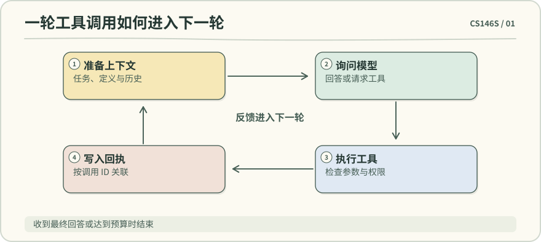
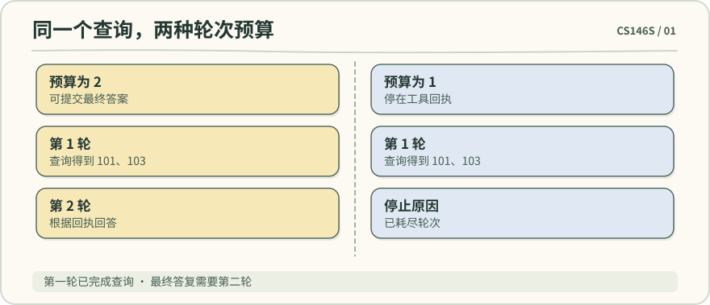

# 第 01 章 · 拆开一个编程代理

**对应 Fall 2026 第 1 周 · The Internals of Coding Agents**

你在终端里打下一句“创建 `test/hello.py`，打印 Hello World”。几秒后，编辑器里真多了一个文件。把模型 API 单独调用一次，它通常也能给你正确的 Python 代码。可这次是谁建了目录？是谁把代码写进磁盘？如果模型说“写好了”，你拿什么确认？

9 月 22 日的第 1 讲用约 200 行 Python 回答这些问题。9 月 24 日的第 2 讲把视线转向 Claude Code 的真实模型请求，从消息里寻找同一个循环，以及产品为了处理更长、更复杂的任务加上的机制。 [第一讲课件](https://docs.google.com/presentation/d/1uztIhjHAG6O_9QOD1N_3wdhwhABml1fANXEN2dGwdbg/htmlpresent) · [第二讲课件](https://docs.google.com/presentation/d/1RZu-p18Qybbgm8WVP2RH04ESc4Bn377B-T9j5-TBFdQ/htmlpresent)

## 1. 第 1 讲 · 约 200 行代码里藏着什么

### 先把三种角色对上

打开课堂示例，先找**模型客户端、工具表和主循环**。模型根据输入的 token 预测后续 token，API 可以把生成结果分成普通文本和结构化工具调用。工具是 Python 函数，负责访问文件。运行器（harness）负责组织会话、调用模型、分派工具、收回结果，以及决定下一轮何时开始。提示词里写一句“你可以写文件”，还得把相应的工具定义和实现接到运行器上，磁盘才会发生变化。 [第一讲课件](https://docs.google.com/presentation/d/1uztIhjHAG6O_9QOD1N_3wdhwhABml1fANXEN2dGwdbg/htmlpresent) · [讲师的 Python 实现讲解](https://www.mihaileric.com/The-Emperor-Has-No-Clothes/)




### 跟着 `hello.py` 跑一圈

下表演示一条可能的路径。模型也可能根据当前目录和工具说明选择先读文件，或者直接在给定路径创建文件。

| 时刻 | 谁在工作 | 这一刻发生了什么 |
| --- | --- | --- |
| ① 收到任务 | 运行器 | 保存用户指令，向模型发送会话和工具定义 |
| ② 找位置 | 模型 → 运行器 | 模型请求 `list_files`。运行器执行函数，把返回的文件列表和调用标识补进会话 |
| ③ 写入 | 模型 → 运行器 | 模型根据目录结果请求编辑工具。实现检查参数并写入。回执带回成功或错误 |
| ④ 复核 | 模型 → 运行器 | 若任务要求确认，模型请求 `read_file`，运行器返回文件实际内容 |
| ⑤ 回答 | 模型 | 根据回执归纳改动。当前回复没有待执行的工具调用时，运行器结束这一轮交互 |

讲师文章里的实现称写入工具为 `edit_file`。传入路径、要替换的旧内容和新内容，可以做局部替换，也可以在约定情形下创建文件。你手头的实现若把工具叫 `write_file`，先看它的覆盖语义和失败返回，尤其是文件已存在时怎么处理。用三次小改动验证一遍。第一次创建 `test/hello.py`，第二次只改要打印的一句话，第三次给出一个找不到的旧片段，观察编辑工具如何把错误反馈给模型。 [讲师的 Python 实现讲解](https://www.mihaileric.com/The-Emperor-Has-No-Clothes/)

### 打开源码，依次找这四个位置

下表按讲师公开文章里的实现来读。课表另附一份完整源码。不同版本可能调整工具名字、API 和参数，自己动手时以手头的文件为准。 [讲师的 Python 实现讲解](https://www.mihaileric.com/The-Emperor-Has-No-Clothes/) · [课表所附源码](https://drive.google.com/file/d/1DxKa_autBOu9s8DvItodgUAwH_pBg7aR/view?usp=drive_link)

| 找什么 | 在代码里观察什么 | 动手改变一处 |
| --- | --- | --- |
| `TOOL_REGISTRY` 和提示词生成 | 注册表把名字映射到函数。文章版根据签名和文档字符串生成工具说明 | 临时让一个工具不可用，确认相应说明和执行入口一同变化 |
| `extract_tool_invocations` | 文章版从回复中的 `tool: …` 行解析名字和 JSON。API 原生工具调用则由客户端解析专门的响应字段 | 比较一行合法调用和普通文本分别去往哪个分支 |
| `edit_file_tool` | 空旧文本走创建或覆盖分支，有旧文本时只替换首处。找不到旧文本就返回失败信息 | 在实验文件里放两个相同片段，确认哪处被改，第三次核对失败后文件内容 |
| `run_coding_agent_loop` | 外层循环持续读用户输入。内层循环收模型输出，有工具就执行并附回执，没有工具就显示答复并回到用户输入 | 在内层打印轮数，比较“打个招呼”和“读文件后改一行” |

文章版的写入函数依赖父目录已存在。试 `test/hello.py` 前先在实验目录建好 `test`，然后运行 `python test/hello.py` 看打印结果。源码中的模型标识、凭据名和依赖随版本而变，跟着客户端初始化处读配置。文章版把回执编码成普通消息中的文本，支持原生工具调用的版本通常用专用结构和调用 ID。两种实现都需要让模型看见上一次执行的结果。

工具调用的标识让运行器把结果交还给对应的请求。假设同一轮模型读了 `hello.py` 和 `README.md`，只有两个文本回执却丢了调用标识，下轮模型很难可靠判断哪一份属于哪个文件。文件不存在、写入失败也有信息量。把错误写成回执，模型才有机会修正路径或向用户说明发生了什么。

### 为什么你看到每轮又带上了历史

第 1 轮模型只收到任务，第 2 轮还要看到目录结果，第 3 轮再带上写入回执。对于这类用消息列表组织的实现，每次发送的上下文随交互增长。假设起始输入 800 token、每一轮给下一轮新增约 400 token，四轮输入大小就是 800、1,200、1,600、2,000，累计 5,600。例子只数逻辑输入，缓存、输出以及不同提供商的计费需要分别看。大段日志和重复读长文件会让增长更快。

如果你在自写代理里打印每轮新增的**消息类型、长度和工具名**，就可以区分增长来自用户追加需求、同一文件被重读，还是错误回执太长。这个观测点会在下一讲连到上下文压缩。

## 2. 第 2 讲 · 顺着 Claude Code 的上下行消息查运行器

Mihail Eric 在访谈中回忆，他用代理观察了课堂演示中 Claude Code 与模型之间的请求和响应，再带学生读系统提示词、规划提示词和压缩提示词。第 2 讲课件把这些机制与工具表、项目说明、Skills、Hooks 和子代理放在一起。它们都可以影响任务的进展，生效位置各有不同。 [讲师访谈约 27 分 21 秒起](https://latent.space/p/cs146s/#:~:text=the%20week%20of%20the%20harness) · [第 2 讲课件](https://docs.google.com/presentation/d/1RZu-p18Qybbgm8WVP2RH04ESc4Bn377B-T9j5-TBFdQ/htmlpresent)


### 先定位一条工具调用，再追下一次请求

下面是本书构造的简化消息记录，字段用易读的名称。假定 Taskboard 的用户请求“看看 `README.md` 有没有测试命令”。

| 方向 | 简化的消息内容 | 从这条消息能判断什么 |
| --- | --- | --- |
| 客户端 → 模型，请求 A | `system` 约定引用文件证据，`tools` 包含 `read_file`，`user` 给出问题 | 这轮模型收到了什么指令、目标和可选动作 |
| 模型 → 客户端，响应 A | `tool_use`，ID `read-1`，参数 `README.md` | 模型提出读取该文件 |
| 客户端 → 模型，请求 B | 本轮上下文出现 `tool_result`，关联 `read-1`，内容含 `python -m unittest discover -s tests -v` | 客户端把这段文本作为该次读取的结果交回模型 |
| 模型 → 客户端，响应 B | “README 里列出了这条测试命令” | 模型根据收到的文字作答。真实文件内容和执行情况还可以分别用文件检查和测试运行确认 |

如果响应 A 请求写入，后面找不到相应结果，可以接着查客户端的权限提示、本地日志和文件差异。用户可能拒绝了、工具可能超时，记录也可能只截取到一半。从一处缺失推断整套实现，很容易把可能性认成事实。普通工具模式下，文件读取、参数校验和用户批准主要由客户端和工具处理。有些服务也提供服务端工具，观察时先核对工具归属。


### 同一套循环，换成生产级会话以后

| 机制 | 从消息或客户端能看到的迹象 | 要再查的问题 |
| --- | --- | --- |
| 系统提示词和项目说明 | 角色、工作约定、环境说明，或被装入上下文的仓库资料 | 哪些条款由工具或权限配置实际落实？ |
| 工具定义 | 可用工具的名字、参数模式和描述 | 工具调用是否通过校验、是否真执行、失败如何返回？ |
| 规划模式 | 在规划有关的请求里出现新的任务句式、计划上下文或工具配置 | 允许读哪些资料？什么时候由用户确认进入实现？ |
| 上下文压缩 | 出现摘要请求或后续会话改用摘要和近期内容 | 压缩因何触发？摘要是否保留了未完成的决定、文件路径和失败用例？ |
| Hooks、Skills、子代理 | 有些行为会反映在回执或另一次模型调用里 | 哪些事件完全在本地发生？怎样关联另一会话和主会话？ |

拿“带历史重发”做一个推演。假设一轮测试把 2,000 行日志带入会话。压缩后留下“列表排序失败”，后来模型可能不知道失败输入是 `2` 和 `10`。如果摘要保留了错误命令、目标规格和关键反例，接手的模型才有望复现。压缩是一种有损的上下文选择。你可以先把决定写到一份可复查的规格里，再把它的路径交给下一轮。 [第 2 讲课件](https://docs.google.com/presentation/d/1RZu-p18Qybbgm8WVP2RH04ESc4Bn377B-T9j5-TBFdQ/htmlpresent)

## 3. 离线跑完第一圈

把下面的程序保存成 `agent_loop.py`，运行 `python agent_loop.py`。模拟模型第一轮固定请求 `list_tasks`，第二轮根据回执生成答复。这样可以逐行验证刚才的循环。要接入真实模型，在 `fake_model` 的位置加客户端适配，按 API 格式传递工具定义、调用标识和回执。这个示例每次处理一条调用，预算单位为模型轮次。

```python
TASKS = [
    {"id": 101, "title": "补测试", "status": "open"},
    {"id": 102, "title": "写文档", "status": "done"},
    {"id": 103, "title": "梳理权限", "status": "open"},
]


def list_tasks(status):
    if status not in ("open", "done"):
        raise ValueError("invalid status")
    return [task for task in TASKS if task["status"] == status]


def fake_model(history, status):
    if history[-1]["role"] == "user":
        return {"tool": "list_tasks", "args": {"status": status}}
    ids = ", ".join(str(task["id"]) for task in history[-1]["result"])
    return {"answer": f"通过查询得到任务 ID：{ids or '无'}"}


def run(status, max_turns):
    history = [{"role": "user", "content": f"列出状态为 {status} 的任务"}]
    for turn in range(1, max_turns + 1):
        action = fake_model(history, status)
        if "answer" in action:
            return action["answer"]

        tool = action.get("tool")
        args = action.get("args")
        if tool != "list_tasks" or not isinstance(args, dict):
            return "停止：工具未授权或参数无效"
        if set(args) != {"status"}:
            return "停止：参数无效"
        try:
            result = list_tasks(args["status"])
        except ValueError as error:
            return f"停止：{error}"

        call_id = f"call-{turn}"
        print(f"{call_id}: {tool}({args}) -> {[task['id'] for task in result]}")
        history.append({"role": "assistant", "call_id": call_id, **action})
        history.append({"role": "tool", "call_id": call_id, "result": result})
    return "停止：轮次预算耗尽"


print(run("open", max_turns=2))
```

预期先看到 `call-1` 和工具返回的 `[101, 103]`，再看到最终回答。改成 `done` 会得到 `102`。把预算改为 `1` 时，查询已经完成，但运行器在模型给出最终回答前达到上限。把状态改为 `archived` 则走参数错误分支。



## 本章验收

官方第一周作业要求在自己的测试仓库观察一段真实 Claude Code 会话，任务要涉及至少两个文件，经历一次失败，并形成明确计划。报告要解读系统提示词、工具设计、错误恢复、计划状态和上下文演变。每项判断都用请求和消息位置作证，标明“观察到”或“推断出”。练习报告可放脱敏后的片段，原始记录留在本机。 [官方作业](https://github.com/mihail911/modern-software-dev-assignments/blob/master/week1/assignment.md) · [报告模板](https://github.com/mihail911/modern-software-dev-assignments/blob/master/week1/writeup.md)

本书练习可以用 Taskboard 和上一节的简化消息完成。

1. **从输出回到代码。** 跑 `open`、`done`、`archived` 和一轮预算四个场景，给每个场景标出工具结果和最后停点。查清哪条日志能证明工具完成，哪条证明模型已回答。
2. **去课堂示例里找同一套循环。** 用 `hello.py` 跑创建、读取、局部修改三次。记录用户输入、工具名、关键回执与最终文件。给工具故意提供一次不存在的旧文本，并解释客户端有没有改动文件。
3. **读透两轮消息。** 用本章简化记录，或者你自己代理的日志，把请求和回执按调用标识配对。标出上下文中唯一的新信息。再写一份三行摘要交给另一个会话，检查它能否准确说出已经完成和还待检查的部分。

## 对照阅读

- **第 1 讲 · 搭建最小编程代理**　课表示例接入真实模型，提供读取文件、列出目录和编辑文件的工具。 [课表所附 Python 源码](https://drive.google.com/file/d/1DxKa_autBOu9s8DvItodgUAwH_pBg7aR/view?usp=drive_link) · [讲师的代码讲解](https://www.mihaileric.com/The-Emperor-Has-No-Clothes/)
- **第 2 讲 · 拆解 Claude Code**　结合真实消息理解系统指令、工具定义、规划和上下文管理。 [9 月 24 日课件](https://docs.google.com/presentation/d/1RZu-p18Qybbgm8WVP2RH04ESc4Bn377B-T9j5-TBFdQ/htmlpresent) · [9 月 24 日课堂记录](https://themodernsoftware.dev/materials/9-24-26-transcript.txt) · [Fall 2026 第 1 周作业目录](https://github.com/mihail911/modern-software-dev-assignments/tree/master/week1)

[返回目录](../../README.md) · [下一章 · 上下文工程与 MCP](../ch02/README.md)
