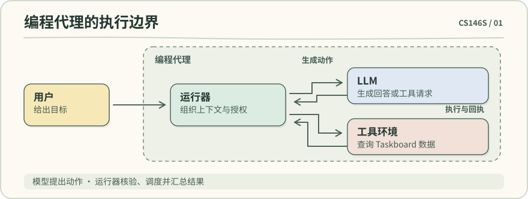
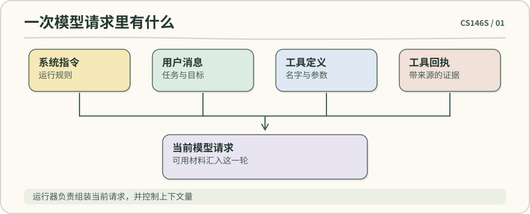
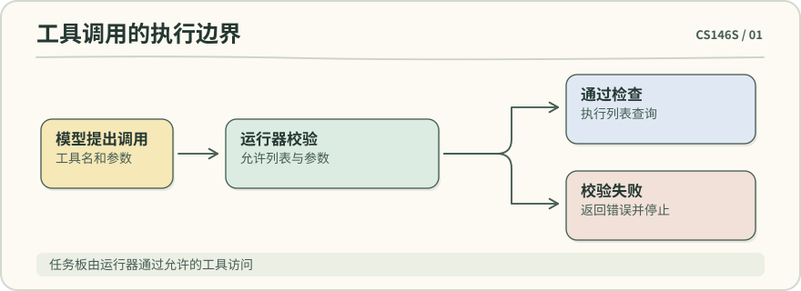

# 第 01 章 · 拆开一个编程代理

**对应 Fall 2026 第 1 周 · The Internals of Coding Agents**

你让代理“数一数还没做完的任务”。它给出“2 条”，这句话背后可能执行过一次查询，也可能只是模型根据文字猜出来的。我们先把查询过程打印到终端，看看答案是在哪一步有了证据。

## 1. 模型产出下一步，运行器安排执行

大语言模型（LLM）把输入切分成 token 并生成后续 token。编程代理的运行器（harness）组织会话，向模型提供当前可用的工具和参数定义，然后解析输出。一次工具调用通常包含工具名、参数和用于关联结果的标识。运行器决定是否执行，工具在环境中工作，运行器再把结果交回模型。




例如，`list_tasks(status="open")` 是模型提出的请求。真正的查询读取任务板数据。若想知道结果来自哪个版本，可以让工具返回快照版本，或让会话记录执行时对应的提交。

## 2. 看清楚模型看到了什么

一次模型请求可能包括系统指令、用户目标、工具定义、最近的对话和工具回执。上下文窗口直接影响一轮能看到哪些信息。在真实仓库里，先用搜索定位入口，再读少量相关文件。判断任务状态时，优先读取当前数据和验证结果。



常见编程工具包括读取、写入、局部编辑与命令执行。读取通常用于采集证据，修改和执行由运行器检查参数、作用域与授权。把一批工具列给模型只是提供接口，执行权仍由运行环境掌握。 [9 月 24 日课堂记录](https://themodernsoftware.dev/materials/9-24-26-transcript.txt)



## 3. 离线跑完第一圈

以下代码可以整段粘贴进终端。模拟模型第一轮固定请求 `list_tasks`，第二轮根据回执生成答复。真实接入时，把模拟模型换成模型客户端，并采用相应 API 的工具调用格式。示例中每条调用单独处理，预算单位为模型轮次。

```sh
python3 - <<'PY'
TASKS = [
    {"id": 101, "title": "补测试", "status": "open"},
    {"id": 102, "title": "写文档", "status": "done"},
    {"id": 103, "title": "梳理权限", "status": "open"},
]


def list_tasks(status):
    if status not in ("open", "done"):
        raise ValueError("invalid status")
    return [task for task in TASKS if task["status"] == status]


def fake_model(history, status):
    if history[-1]["role"] == "user":
        return {"tool": "list_tasks", "args": {"status": status}}
    ids = ", ".join(str(task["id"]) for task in history[-1]["result"])
    return {"answer": f"通过查询得到任务 ID：{ids or '无'}"}


def run(status, max_turns):
    history = [{"role": "user", "content": f"列出状态为 {status} 的任务"}]
    for turn in range(1, max_turns + 1):
        action = fake_model(history, status)
        if "answer" in action:
            return action["answer"]

        tool = action.get("tool")
        args = action.get("args")
        if tool != "list_tasks" or not isinstance(args, dict):
            return "停止：工具未授权或参数无效"
        if set(args) != {"status"}:
            return "停止：参数无效"
        try:
            result = list_tasks(args["status"])
        except ValueError as error:
            return f"停止：{error}"

        call_id = f"call-{turn}"
        print(f"{call_id}: {tool}({args}) -> {[task['id'] for task in result]}")
        history.append({"role": "assistant", "call_id": call_id, **action})
        history.append({"role": "tool", "call_id": call_id, "result": result})
    return "停止：轮次预算耗尽"


print(run("open", max_turns=2))
PY
```

预期先看到 `call-1` 和工具返回的 `[101, 103]`，再看到最终回答。改成 `done` 会得到 `102`。把预算改为 `1` 时，查询已经完成，但运行器在模型给出最终回答前达到上限。把状态改为 `archived` 则走参数错误分支。


## 本章验收

把这四次运行的终端记录放进自己的实验笔记。标出哪一行是工具回执、哪一行是最终回答，以及为何工具成功和会话完成可以分别发生。试着解释为什么应当由运行器控制轮次上限。

## 对照阅读

- 课程第 1 周的运行器、系统指令与工具定义。 [Fall 2026 课纲](https://themodernsoftware.dev/) · [9 月 24 日课堂记录](https://themodernsoftware.dev/materials/9-24-26-transcript.txt)

[返回目录](../../README.md) · [下一章 · 上下文工程与 MCP](../ch02/README.md)
