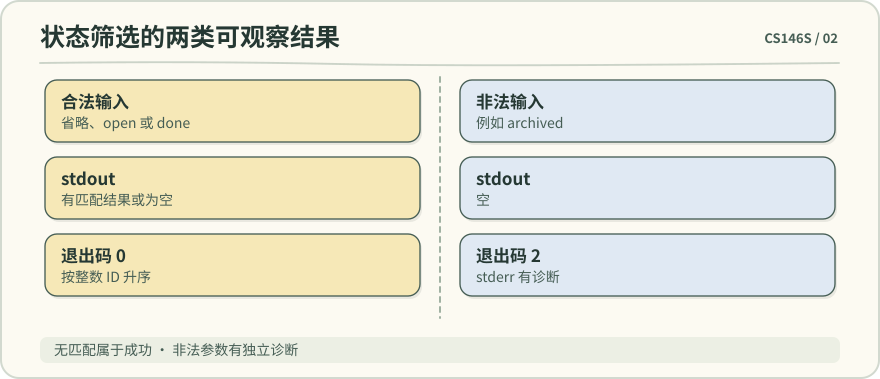
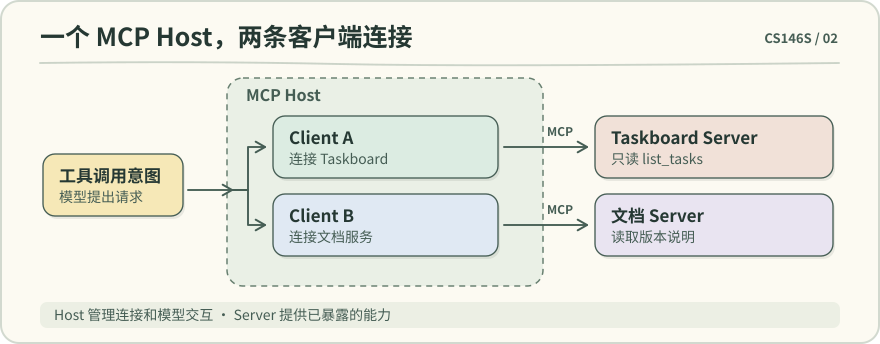

# 第 02 章 · 上下文工程与 MCP

**对应 Fall 2026 第 2 周 · Advanced Context Engineering**

任务板要增加状态筛选。一句“支持筛选”留下了至少三个问题：省略状态时返回什么、输出怎么排序、未知状态怎么处理。模型可以写出语法正确的实现，但这三个答案决定用户看到的行为。

## 1. 先把问题放进上下文

给代理提供目标、现状入口、约束、验收例和证据所在位置。比如把第 1 章的三条任务当作样例，交代已有输出格式，再让它列出待确认的问题。搜索得到的源码和工具输出属于证据，来源与提交号可以一并记录。会话过长时，把已确认的决策和未解决的问题写回文档，开一个新会话时再读取。


## 2. 把 RePPIT 的中间结果留在仓库

**Research → Propose → Plan → Implement → Test**。先查现有列表的排序和参数行为，再比较把筛选放在 CLI 还是领域层的代价。选择方案后，把修改路径、测试点和验证顺序写下来。实现与验证会来回迭代，发现行为未定义时回到规格确认。 [9 月 29 日课堂记录](https://themodernsoftware.dev/materials/9-29-26-transcript.txt)


Taskboard 示例选择在领域层处理筛选和排序，CLI 处理语法与退出码。这样 CLI 和未来的只读工具可以复用同一套行为。

| 调用 | 标准输出中的任务 ID | 退出码 |
| --- | --- | --- |
| `taskboard list` | 101、102、103，升序 | 0 |
| `taskboard list --status open` | 101、103，升序 | 0 |
| `taskboard list --status done` | 102 | 0 |
| `taskboard list --status archived` | 空，诊断写到 stderr | 2 |
| 合法筛选且无匹配任务 | 空 | 0 |

每条有效结果按 `ID<TAB>标题` 输出一行。命令名用于描述目标接口，练习中可用 `python3 -m taskboard.cli list` 调用。任务样例和可观察行为一起写进 `docs/list-spec.md`，接着再把表格变成测试。



## 3. MCP 把工具接到代理上

MCP（Model Context Protocol）定义 Host、Client 和 Server 的通信关系。Host 管理模型交互和多个客户端连接，Client 代表 Host 与某个 Server 进行协议通信，Server 暴露工具等能力。模型发起工具调用意图后，宿主负责选择连接、发送请求并处理结果。本书的架构图聚焦角色，传输和消息用所选版本的规范核对。 [MCP 架构规范](https://modelcontextprotocol.io/specification/2026-07-28/architecture) · [10 月 1 日课堂记录](https://themodernsoftware.dev/materials/10-1-26-transcript.txt)



给 `list_tasks` 的输入定义枚举，让代理在调用前就知道合法状态。缺省让服务列全部。返回结构化任务列表，并把业务错误与空结果区分开。工具描述清楚副作用，这里只有只读查询。

```json
{
  "type": "object",
  "properties": {
    "status": {
      "type": "string",
      "enum": ["open", "done"],
      "description": "Omit to list all tasks."
    }
  },
  "additionalProperties": false
}
```


## 本章验收

1. 保存规格和输入 schema。根据验收表写出至少四条断言，把种子数据故意乱序以验证排序。可以先沿用第 1 章的内存数据。
2. 给“空列表”和“非法状态”各写一个预期返回结果，解释调用方如何区分它们。
3. 如果已有支持 MCP 的本地宿主，可用所选版本的 SDK 实现只读 Server。纯离线练习可以直接调用领域函数，根据 schema 写出请求、结果和错误的样例。

## 对照阅读

- 讲师用编码任务串起调查、方案、计划、实现和测试。 [RePPIT 原文](https://home.mlops.community/public/blogs/reppit-a-framework-to-ship-production-code-2-3x-faster)
- 查看规格、计划、任务与实现如何形成工件。 [GitHub Spec Kit](https://github.com/github/spec-kit)

[上一章](../ch01/README.md) · [返回目录](../../README.md) · [下一章](../ch03/README.md)
