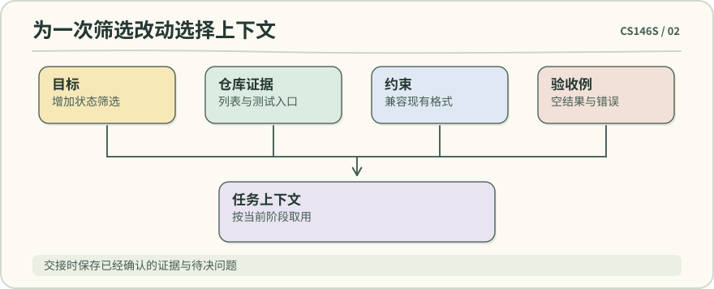
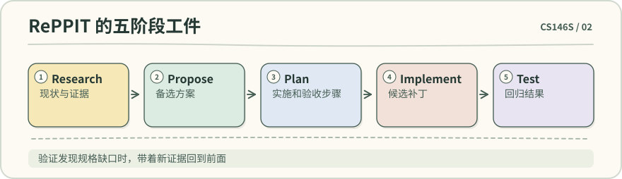
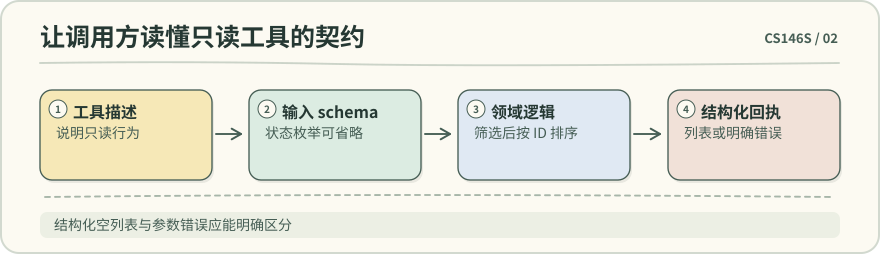

# 第 02 章 · 上下文工程与 MCP

**对应 Fall 2026 第 2 周 · Advanced Context Engineering**

你把“增加状态筛选”交给编码代理。五分钟后，代码和测试都出来了。你打开终端跑旧命令，发现它现在只显示 `open` 任务。代理替你选了一个默认值，测试又照着这个默认值写。程序跑通了，原来依赖“列出全部”的调用者却遇到了回归。

9 月 29 日第 3 讲解决的是怎样把想法变成能验收的任务。10 月 1 日第 4 讲接着问，任务需要现场信息时，怎样给代理一个标准接口。课堂用 RePPIT、规格驱动开发、MCP 工具发现和调用串起这两件事。 [第 3 讲课件](https://docs.google.com/presentation/d/17brqoQQZHF3K82WgYaV6urAV3Q7iIwyGUBYRvSuY8QY/htmlpresent) · [第 4 讲课件](https://docs.google.com/presentation/d/1q2cB1a7P4XsR0UJqE0RmtZFeggNOLdPaSnOpbBVewHA/htmlpresent)

## 1. 先把问题放进上下文

把用户目标、当前事实和新设计写成三段。当前事实可以查 `cli.py`、现有测试和一次基线运行。新设计由人确认，例如“省略参数时列出全部，沿用现有输出，非法值写到 stderr”。再请代理回报它从哪些文件得出结论，以及还有什么未知。目标说“让用户更快看到未完成任务”，规格说“传 `--status open` 时只打印 open 条目”，两句话承担不同职责。

| 任务 | 让代理先做什么 | 中途核对什么 |
| --- | --- | --- |
| 修改一处帮助文字 | 给出目标文字与命令入口，直接修改并检查 `--help` | 终端实际显示的句子 |
| 新增状态筛选 | 先调查现有 CLI、默认行为和测试，再给方案 | 旧命令、非法参数和无结果的行为 |
| 跨模块迁移状态字段 | 分成调查、兼容层、迁移和清理，每步保存工件 | 每一步对旧数据的回归结果和待确认问题 |

提示中可以放一个正例和一个边界例。例如“`open` 输出 101、103”，“合法状态没有记录时 stdout 为空且退出码是 0”。两个例子一起给，模型才容易理解空输出可以是正常结果。资料多时先给入口和搜索方向，遇到决策再读相关文件。过期的规格和完整日志也会占掉上下文，还可能把旧约定说得比新约定更显眼。



## 2. 把 RePPIT 的中间结果留在仓库

**Research → Propose → Plan → Implement → Test**。每一步都留下一段下一位开发者能接手的证据。

| 阶段 | 在 Taskboard 里怎么做 | 可以留下什么 |
| --- | --- | --- |
| Research · 调查 | 跑旧版 `list`，找 CLI 入口、排序位置和调用方 | 基线提交、命令、实际输出、未知项 |
| Propose · 提方案 | 比较在 CLI 中筛选和在领域函数中筛选。再接一个 MCP 工具时，后者可复用 | 两种方案影响的入口与具体代价 |
| Plan · 写计划 | 明确先补断言，再改领域逻辑，最后接参数解析和 CLI | 每步改哪些文件、跑哪个检查 |
| Implement · 实现 | 按一个小改动一轮验证。遇到未定义的重复 ID 行为，回到规格确认 | 小补丁和实现过程中作出的决定 |
| Test · 验收 | 用乱序输入、非法参数、无匹配和旧调用各跑一遍 | 命令、实际输出、退出码和还没验证的条件 |

**规格回答“怎么知道做对了”，计划回答“准备怎么做”。** 把 `argparse` 写进计划即可，用户真正依赖的是 stdout、stderr 和退出码。下轮实现换一种参数解析方式，只要这些行为保持一致，规格还可使用。任务长时先把确认过的决定写进 `docs/list-spec.md`，新会话从文件读，再补上本轮差异和待办。 [9 月 29 日课堂记录](https://themodernsoftware.dev/materials/9-29-26-transcript.txt) · [RePPIT 原文](https://home.mlops.community/public/blogs/reppit-a-framework-to-ship-production-code-2-3x-faster)



Taskboard 示例选择在领域层处理筛选和排序，CLI 处理语法与退出码。这样 CLI 和未来的只读工具可以复用同一套行为。

| 调用 | 标准输出中的任务 ID | 退出码 |
| --- | --- | --- |
| `taskboard list` | 101、102、103，升序 | 0 |
| `taskboard list --status open` | 101、103，升序 | 0 |
| `taskboard list --status done` | 102 | 0 |
| `taskboard list --status archived` | 空，诊断写到 stderr | 2 |
| 合法筛选且无匹配任务 | 空 | 0 |

每条有效结果按 `ID<TAB>标题` 输出一行。命令名用于描述目标接口，练习中可用 `python3 -m taskboard.cli list` 调用。任务样例和可观察行为一起写进 `docs/list-spec.md`，接着再把表格变成测试。


## 3. MCP 把工具接到代理上

第 1 章运行器直接调用 Python 函数。如果终端代理、编辑器和桌面应用都要访问任务板，就得把这份能力接给多种宿主。MCP（Model Context Protocol）约定客户端怎样发现和调用服务的工具，也定义了资源、提示模板等能力。**Host** 是用户打开的应用，负责模型交互和权限。**Client** 是 Host 用来跟某个 MCP Server 通信的一侧。**Server** 暴露任务板的能力，可以调用本地函数，也可以包住已有服务。 [MCP 架构规范](https://modelcontextprotocol.io/specification/2026-07-28/architecture)


追一遍“帮我列出 open 任务”。客户端发现服务端能力，通过 `tools/list` 得到名称、描述和输入模式。宿主将合适的工具提供给模型。模型选中 `list_tasks` 并返回参数，宿主检查之后由客户端发出 `tools/call`，服务器执行，再沿原路把结果送回。到模型的一段走模型 API，到 Taskboard 的一段走 MCP。你可以从两边各自的日志区分模型选错工具、宿主拒绝调用和服务器执行失败。 [第 4 讲课件](https://docs.google.com/presentation/d/1q2cB1a7P4XsR0UJqE0RmtZFeggNOLdPaSnOpbBVewHA/htmlpresent) · [MCP 工具规范](https://modelcontextprotocol.io/specification/2026-07-28/server/tools)

本地进程常用 `stdio`，宿主启动服务，从标准输入与输出交换协议消息，服务的调试日志走 stderr。远端服务常用 Streamable HTTP，需要另外处理身份、传输和超时。同样的工具调用可以套在两种传输上。课件用客户端会话解释调用关系。实现时按 SDK 和双方支持的协议版本选握手流程。`2026-07-28` 版用 `server/discover` 探测能力，兼容旧版本时还可能遇到 `initialize` 握手。 [MCP 传输规范](https://modelcontextprotocol.io/specification/2026-07-28/basic/transports) · [MCP SDK 的版本说明](https://csharp.sdk.modelcontextprotocol.io/v2/concepts/stateless/stateless.html)

### 把筛选做成一个工具调用

给 `list_tasks` 写清“按可选状态返回 ID 升序的任务，省略状态时返回全部”，并声明只读。把状态枚举给模型，服务器照样要校验实际请求。成功时交回结构化任务列表，遇到合法空结果就交回 `{"tasks": []}`。参数非法或执行异常，有各自可识别的错误信息。

```json
{
  "type": "object",
  "properties": {
    "status": {
      "type": "string",
      "enum": ["open", "done"],
      "description": "Omit to list all tasks."
    }
  },
  "additionalProperties": false
}
```



把连接发现、协商所需的元数据先略去，一次调用的 JSON-RPC 请求主体可以读成这样。

```json
{
  "jsonrpc": "2.0",
  "id": 7,
  "method": "tools/call",
  "params": {"name": "list_tasks", "arguments": {"status": "open"}}
}
```

服务端响应沿用 `id: 7`。本例的成功 `result` 可含 `structuredContent`，其中 `tasks` 是带 `id` 和 `title` 的数组。兼容需要文本的宿主时可同时填 `content`。区分协议级错误和工具级错误，后者可在工具结果里用 `isError` 表达。模型收到可读的提示“允许 open、done”，就有机会纠正一次参数错误。遇到连接超时，调用者需要知道是否值得重试。这个查询只读，重试和写入工具的风险不同。 [MCP 工具规范](https://modelcontextprotocol.io/specification/2026-07-28/server/tools)

```json
{
  "jsonrpc": "2.0",
  "id": 7,
  "result": {
    "content": [{"type": "text", "text": "开着的任务：101 补测试，103 梳理权限"}],
    "structuredContent": {
      "tasks": [{"id": 101, "title": "补测试"}, {"id": 103, "title": "梳理权限"}]
    }
  }
}
```

排障时先看停在哪一层。工具没出现在 `tools/list` 里，查服务配置和发现结果。工具已发现，模型总传 `"Open"`，查枚举如何提供给模型、描述是否有歧义。服务返回的 101、103 正确，模型却回答“三条”，查宿主送回模型的实际回执和最后的归纳。把三种错误记成不同测试，下一次能更快定位。

如果代理要先列全部、再为每条取详情、最后自己做筛选，最简单的问题也得跑多轮。服务端有领域知识，可以在 `list_tasks(status)` 一次完成筛选，默认只返回回答所需字段。工具变多后，同样的原则用在发现阶段，先找相关工具，再把必要的定义给模型。 [第 4 讲课件](https://docs.google.com/presentation/d/1q2cB1a7P4XsR0UJqE0RmtZFeggNOLdPaSnOpbBVewHA/htmlpresent)

## 本章验收

官方第 2 周作业把接口设计推进到真实的第三方 API。它要求用 stdio 接入至少三个能够串联的工具，含一个写工具，并在服务端处理第三方 OAuth 令牌的获取、缓存与刷新。可以想成“搜索任务 → 传入任务 ID 读详情 → 在明确授权后更新状态”。在这个例子里 OAuth 是 MCP Server 访问上游 API 的授权，远端 MCP 客户端访问服务器时还可能另有一层授权。检查两个身份分别能访问哪些资源。 [官方第 2 周作业](https://github.com/mihail911/modern-software-dev-assignments/blob/master/week2/assignment.md)

Taskboard 从只读查询起步，先检验模型能不能稳定选对参数和解释回执。

1. 保存规格和输入 schema。根据验收表写出至少四条断言，把种子数据故意乱序以验证排序。可以先沿用第 1 章的内存数据。
2. 给“空列表”和“非法状态”各写一个预期返回结果，解释调用方如何区分它们。
3. 如果已有支持 MCP 的本地宿主，可用所选版本的 SDK 实现只读 Server。纯离线练习可以直接调用领域函数，根据 schema 写出请求、结果和错误的样例。

## 对照阅读

- 讲师用编码任务串起调查、方案、计划、实现和测试。 [RePPIT 原文](https://home.mlops.community/public/blogs/reppit-a-framework-to-ship-production-code-2-3x-faster)
- 查看规格、计划、任务与实现如何形成工件。 [GitHub Spec Kit](https://github.com/github/spec-kit)

[上一章](../ch01/README.md) · [返回目录](../../README.md) · [下一章](../ch03/README.md)
