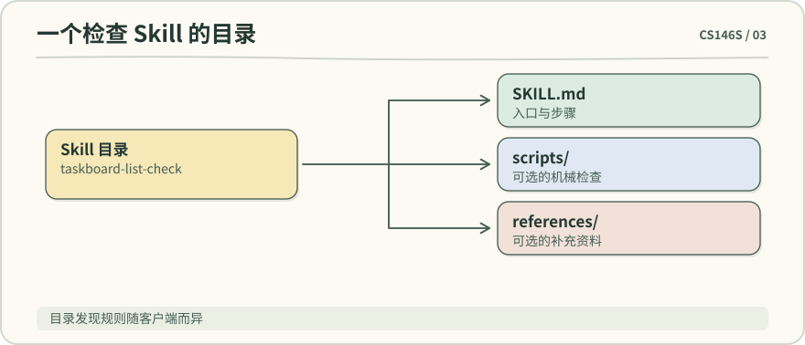
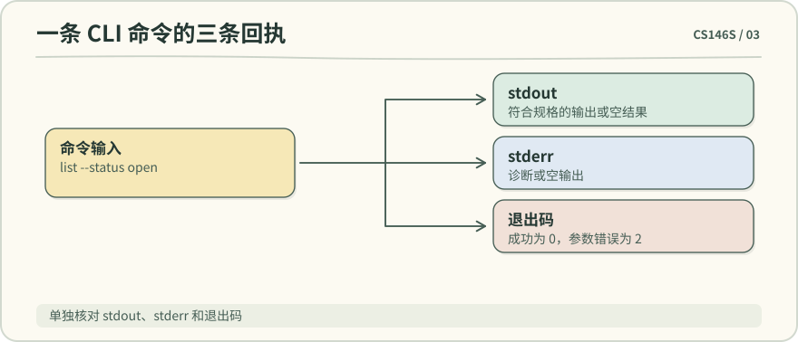
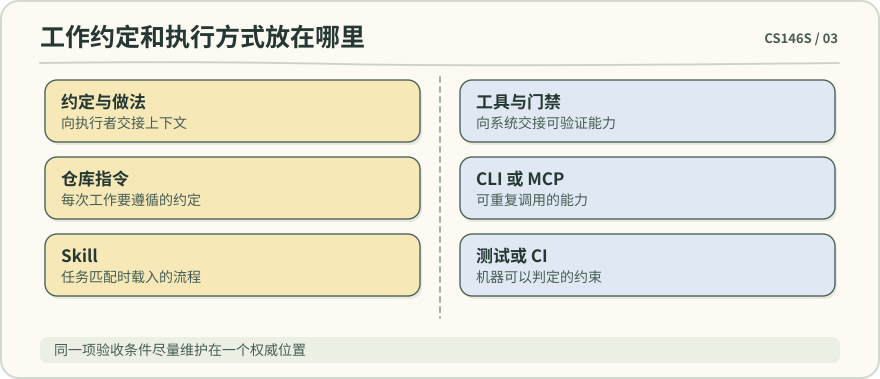
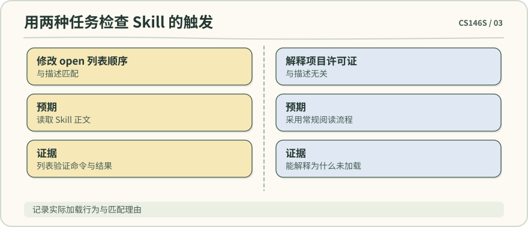

# 第 03 章 · Agent Skills 与命令行

**对应 Fall 2026 第 3 周 · Agent Skills and CLI**

上章写好了列表规格。过几天再改筛选时，你会重新交代怎样跑测试、检查 stderr、记录相关差异。只要这些步骤经常重复，就可以把入口和证据要求存成 Skill。

## 1. 把何时使用、怎么做、留下什么写在一起

Agent Skills 开放格式以 `SKILL.md` 为入口。客户端通常先发现名称与描述，在任务匹配时载入正文，再按需读取脚本、参考资料或资源文件。线索应足够具体，帮助客户端在“修改 Taskboard 列表行为”时找到这个 Skill。客户端如何发现目录、运行脚本和访问网页取决于它自己的实现与权限。 [Agent Skills 规范](https://agentskills.io/specification)


在实验仓库为 Skill 建一个子目录，实际放置位置以客户端约定为准。在目录内创建 `SKILL.md`。这里的检查以第 2 章的列表规格为准。

```markdown
---
name: taskboard-list-check
description: Verify Taskboard CLI changes affecting list output, status filters, or exit codes.
---

# Verify Taskboard list behavior

1. Read docs/list-spec.md and inspect the changed files.
2. Run python3 -m unittest discover -s tests -v from the repository root.
3. Check the all, open, done, empty and invalid-status cases against the spec.
4. Report the command, actual exit code, failed assertions, and affected files.
```



## 2. 让 CLI 给出可检查的结果

可组合的 CLI 把主输出交给 stdout，把诊断写入 stderr，并用退出码表达执行状态。第 2 章约定非法状态返回 2。假如验证脚本只检查终端有没有输出，合法但无匹配时的空结果也可能被当成失败。以退出码和精确输出为准。



重复的机械检查可以留在脚本里，Skill 说明何时执行、执行前需要什么以及如何解释结果。网页资料也可以作为 Skill 的输入，记录页面和引用段落。运行器仍需按自己的权限边界处理网页和外部命令。

## 3. 指令、工具和 Skill 怎么选

| 需要反复复用的内容 | 适合放在哪里 |
| --- | --- |
| 仓库内每次工作都要遵循的约定 | 仓库指令 |
| 只在某些任务中触发的多步做法 | Skill |
| 调用方需要重复使用的结构化能力 | CLI 或 MCP 工具 |
| 任何改动都必须满足的条件 | 测试或 CI 门禁 |



## 本章验收

准备两个请求，“修复 open 列表顺序”和“解释这个项目的许可证”。用客户端或手工扮演发现环节，判断哪条匹配 Skill。随后按正文走一遍测试，把退出码和真实失败信息写进结果。若暂时只有第 1 章原型，先保存 Skill，并在第 5 章实现 CLI 后复跑。



## 对照阅读

- 第 3 周主题和课件入口。 [Fall 2026 课纲](https://themodernsoftware.dev/)
- 核对 front matter、目录布局与渐进加载。 [Agent Skills 规范](https://agentskills.io/specification)

[上一章](../ch02/README.md) · [返回目录](../../README.md) · [下一章](../ch04/README.md)
