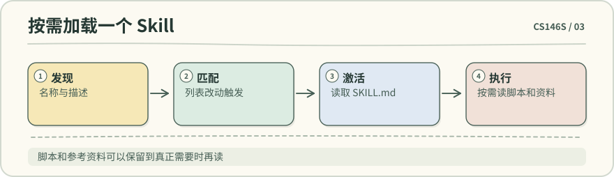

# 第 03 章 · Agent Skills 与命令行

**对应 Fall 2026 第 3 周 · Agent Skills and CLI**

第三次修改列表功能时，你又打了一整段话：“从仓库根目录跑测试。检查 open、done 和非法输入。别忘了空列表也算成功。”下一次把任务交给另一个会话时，这段经验又得重说。把它写进一个 Skill，以后遇到同类任务，代理可以按需读到它。

第 5 讲用代码理解、验证、代码风格和网页处理介绍 Skills。10 月 8 日第 6 讲由 Lee Robinson 讨论持续运行的代理。固定入口与验证步骤能帮助下一次运行接手，也能帮助人看清后台代理做到了哪一步。 [第 5 讲课件](https://docs.google.com/presentation/d/15bPu5c-i8D8McTh6l7SpUPk2n9M_Y-CdDQLfyzL8RD8/htmlpresent) · [第 6 讲录像](https://www.youtube.com/watch?v=L1OBRtfPS34)

## 1. 把何时使用、怎么做、留下什么写在一起

Agent Skills 开放格式以 `SKILL.md` 为入口。客户端通常先发现名称与描述，在任务匹配时载入正文，再按需读取脚本、参考资料或资源文件。线索应足够具体，帮助客户端在“修改 Taskboard 列表行为”时找到这个 Skill。客户端如何发现目录、运行脚本和访问网页取决于它自己的实现与权限。 [Agent Skills 规范](https://agentskills.io/specification)

想像工具栏上有五十个流程。把五十份全文带进每次模型请求，当前任务的证据就得和大量无关步骤争上下文。发现阶段拿到 `name` 和 `description`，选中后再读正文，用到某个命令时才去看 `scripts/` 或 `references/`，这就是渐进加载。把 `description` 当成触发提示。“帮助写代码”太宽，“修改 Taskboard 的列表、状态筛选或退出码时验证 CLI 契约”则能让普通列表请求和仓库改动有清楚的入口。



在实验仓库建 `taskboard-list-check/`，上一级目录按客户端的发现规则选择。这里的 `SKILL.md` 指向第 2 章的规格，并把需要判断的分支写下来。

```markdown
---
name: taskboard-list-check
description: Verify Taskboard CLI changes affecting list output, status filters, or exit codes.
---

# Verify Taskboard list behavior

1. Read docs/list-spec.md and inspect the changed files.
2. Run `python -m unittest discover -s tests -v` from the repository root.
3. If the command discovers zero tests, check the working directory and test layout before reporting success.
4. If sorting or filtering changed, compare exact output for all, open, done and empty cases. If argument handling changed, check stderr and exit status for invalid input.
5. Report the command, test count, actual exit code, failed assertions, and affected files.
```


## 2. 让 CLI 给出可检查的结果

可组合的 CLI 把主输出交给 stdout，把诊断写入 stderr，并用退出码表达执行状态。第 2 章约定非法状态返回 2。假如验证脚本只检查终端有没有输出，合法但无匹配时的空结果也可能被当成失败。以退出码和精确输出为准。


重复的机械检查可以留在脚本里，Skill 说明何时执行、执行前需要什么以及如何解释结果。网页资料也可以作为 Skill 的输入，记录页面和引用段落。运行器仍需按自己的权限边界处理网页和外部命令。

用两个例子感受区别。检查命令 `python -m taskboard.cli list --status open` 固定由 Python 程序做筛选。Skill 则要根据差异判断需不需要补测 stderr，以及有失败时先找参数解析还是领域函数。网页任务也一样，可以先用客户端认可的网页读取能力取得资料，再用 Skill 规定如何找原文、核对版本、保存链接和摘出事实。

试着想一条适合自己仓库的工作流。比如 Flutter 教学项目“加入一篇英语课文”至少要检查课文 ID、字幕与语音资源、实际能否播放。音频报错时，下一步应先确认路径配置、资源是否打包与设备输出。这个分支值得写进 Skill。单纯运行同一个已维护的检查命令，用现成 CLI 入口就够。

## 3. 指令、工具和 Skill 怎么选

| 需要反复复用的内容 | 适合放在哪里 |
| --- | --- |
| 仓库内每次工作都要遵循的约定 | 仓库指令 |
| 只在某些任务中触发的多步做法 | Skill |
| 调用方需要重复使用的结构化能力 | CLI 或 MCP 工具 |
| 任何改动都必须满足的条件 | 测试或 CI 门禁 |


## 本章验收

准备三类请求并留下触发结果。明确匹配的“修复 open 列表顺序”应启用 Skill。近义的“筛选后任务怎么倒序打印了？”也应启用。无关的“解释这个项目的许可证”只需读取许可证。若实际判断和预期不一致，先改描述，再用同样的请求复测。启动后还要看结果，跑了哪条命令，发现几条测试，是否遵守异常分支。若暂时只有第 1 章原型，先测触发，在第 5 章实现 CLI 后再测执行质量。


## 对照阅读

- 第 3 周作业要求在真实仓库选一个重复流程，编写 Skill，验证适用和无关场景，再根据结果修订描述或具体步骤。 [官方第 3 周作业](https://github.com/mihail911/modern-software-dev-assignments/blob/master/week3/assignment.md) · [第 5 讲课件](https://docs.google.com/presentation/d/15bPu5c-i8D8McTh6l7SpUPk2n9M_Y-CdDQLfyzL8RD8/htmlpresent)
- 核对 front matter、目录布局与渐进加载。 [Agent Skills 规范](https://agentskills.io/specification)

[上一章](../ch02/README.md) · [返回目录](../../README.md) · [下一章](../ch04/README.md)
