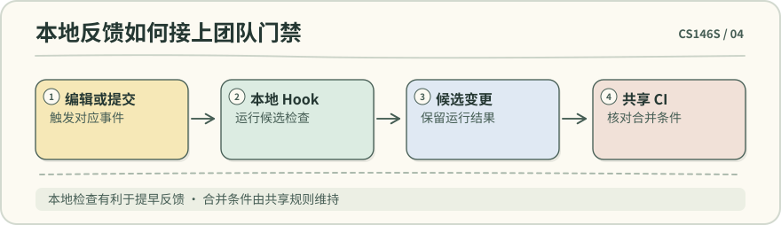
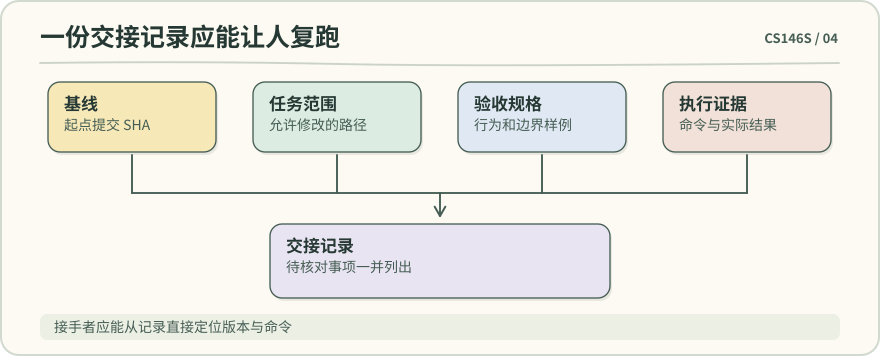

# 第 04 章 · 定制代理和仓库

**对应 Fall 2026 第 4 周 · Customizing Your Agent and Repository**

实现者说“测试全过了”，评审者却在不同目录运行，跑到了零条测试。两个人用的是同一个仓库，实际采用的是两套检查入口。我们把工作目录、命令和验收依据写进仓库，再让机器核对关键条件。

## 1. 把环境知识留在仓库

`AGENTS.md` 可以写启动方法、目录分工和仓库习惯。部分客户端识别 `CLAUDE.md` 等专属文件。文件发现、作用域和覆盖规则随客户端而异，可以在子目录发起一次小任务验证生效规则。


Taskboard 根目录的示例内容如下。

```markdown
# Taskboard contributor instructions

- Run commands from the repository root.
- Run python3 -m unittest discover -s tests -v.
- Keep status filtering in taskboard/domain.py.
- Keep CLI parsing and exit codes in taskboard/cli.py.
- Check list behavior against docs/list-spec.md.
```

## 2. Hook 把事件与检查接起来

Hook 按运行器支持的事件触发操作。比如编辑后运行本地测试，或在提交前检查差异里是否有空白错误。实际阻断行为由具体 Hook 的事件类型、脚本结果和运行器定义。Git 的本地 Hook 可作为反馈入口，团队共享的必过条件应由 CI 或受保护分支规则执行。



先从仓库根目录手工复跑检查。对已暂存的差异用 `git diff --cached --check`，对未暂存的差异用 `git diff --check`。需要挑一个放到 Hook 时，先说清楚它对应哪种事件和哪份差异。


## 3. 拆成三个角色，传递证据

规划者读规格并提出实现路径，实现者生成小补丁并运行验证，评审者用规格和差异独立判断。在线性小任务里，三个角色可以由同一个人依次承担。换会话时，交接规格路径、基线提交、允许改动的范围和已跑命令。评审结果还要写清未验证的假设。


## 本章验收

1. 创建实验仓库的 `AGENTS.md`，用一份规格文档维护列表行为，再从指令文件指过去。
2. 在实验文件中暂存一行带行尾空格的临时改动，运行 `git diff --cached --check`，确认检查失败。修掉后重新暂存，确认通过。若启用了自动 Hook，再检查触发时机是否符合预想。
3. 写一份交接记录，包含基线提交、范围、相关规格、命令、观察到的结果。让下一位读者只凭记录复跑一次。



## 对照阅读

- 可查看目录说明与作用域示例。 [AGENTS.md 格式](https://agents.md/)
- 区分客户端指令、技能、Hook 和子代理。 [Claude 工程文章](https://claude.com/resources/articles/steering-claude-code-skills-hooks-rules-subagents-and-more) · [Fall 2026 课纲](https://themodernsoftware.dev/)

[上一章](../ch03/README.md) · [返回目录](../../README.md) · [下一章](../ch05/README.md)
