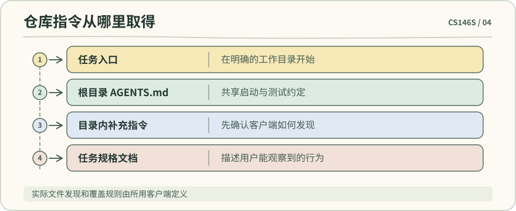
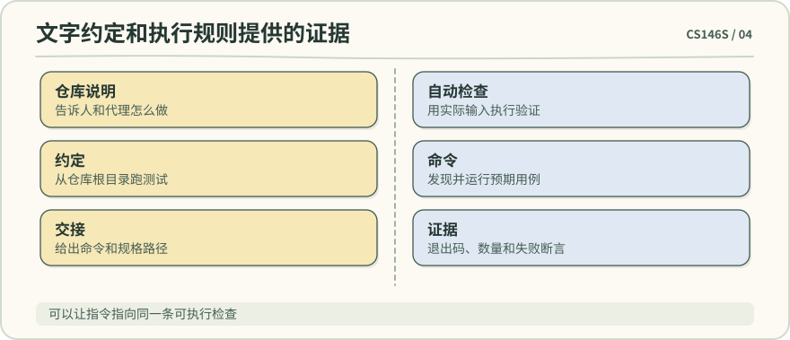
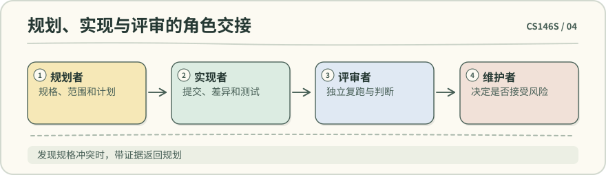

# 第 04 章 · 定制代理和仓库

**对应 Fall 2026 第 4 周 · Customizing Your Agent and Repository**

终端弹出一个醒目的 `OK`。你往上一滚，才看见 `Ran 0 tests`。实现者记得命令，漏了运行目录。评审者接到了“测试全过”的结论，也就没有继续找。这个错误用模型换一遍照样可能发生，因为环境和验收标准一直靠口头传递。

10 月 13 日第 7 讲用仓库说明、Hooks、Skills 和子代理解决这类协作问题。10 月 15 日第 8 讲的课表来宾是 Claude Code 创建者 Boris Cherny。本章用公开课件和 Claude 的工程资料解释各机制，并用 Taskboard 串起一次完整交接。 [第 7 讲课件](https://docs.google.com/presentation/d/152VaUifBKH4T6hxd6fCKKM9kJTSAuBmkF8zSYwuTYAo/htmlpresent) · [课程课表](https://themodernsoftware.dev/) · [Claude 工程资料](https://claude.com/resources/articles/steering-claude-code-skills-hooks-rules-subagents-and-more)

## 1. 把环境知识留在仓库

`AGENTS.md` 可以写启动方法、目录分工、构建和测试入口、代码约定，以及生成文件该怎样处理。部分客户端识别 `CLAUDE.md` 等专属文件。根目录说明带人找到入口，模块内说明可以记录当地约定。文件发现、作用域和覆盖规则随客户端而异。把一次任务放到真实的子目录里，检查它引用的是哪一份说明，再验证引用的命令实际能跑。

判断值不值得写进去，问一句：“它第一次打开仓库时，能从其他文件可靠地得到这信息吗？”`taskboard/domain.py` 管筛选与排序，`taskboard/cli.py` 管用户接口。这种地图值得留。随随机种子、测试依赖或生成脚本版本变动的细节，宜指向维护它的文件。根说明把“去哪里查”和“哪些约定经常出错”留给下一位读者即可。



Taskboard 根目录的示例内容如下。

```markdown
# Taskboard contributor instructions

- Run commands from the repository root.
- Run `python -m unittest discover -s tests -v` and report the discovered test count.
- Keep status filtering in taskboard/domain.py.
- Keep CLI parsing and exit codes in taskboard/cli.py.
- Check list behavior against docs/list-spec.md.
```

## 2. Hook 把事件与检查接起来

Hook 是运行器在指定事件触发的操作。编辑完成后启动快测，下一轮模型就能尽早知道刚才的修改是否有问题。操作前的 Hook 有机会校验参数并阻止操作。实际阻断行为由具体事件、脚本结果和运行器定义。如果在 Claude Code 看见 `PreToolUse`、`PostToolUse`、`UserPromptSubmit` 或 `PreCompact`，先定位它的触发点，再看那个点能报告、修改还是阻断。 [Claude Code Hooks 参考](https://code.claude.com/docs/en/hooks)

| 时刻 | Taskboard 可以做什么 | 应观察到什么 |
| --- | --- | --- |
| 文件修改后 | 快速跑相关测试，把失败反馈给当前会话 | 及时得到断言失败的位置 |
| Git 提交前 | 只检查已暂存的变化 | 正在进入提交的内容符合检查 |
| PR 合并前 | CI 跑完整规格测试，并在分支规则里设为必过 | 团队成员收到同一版本的结果 |

一个本地检查可能被跳过、超时或忘记安装。团队要靠 CI 执行必过条件，并查看检查针对的提交。把耗时很长的全量测试挂到每次写文件事件，代理改四处就要等四次。先分清什么时候需要快速反馈，什么时候需要完整证据。


先从仓库根目录手工复跑检查。对已暂存的差异用 `git diff --cached --check`，对未暂存的差异用 `git diff --check`。需要挑一个放到 Hook 时，先说清楚它对应哪种事件和哪份差异。



## 3. 拆成三个角色，传递证据

规划者先问“谁依赖旧的 `list` 行为”，把规格和改动范围交给实现者。实现者回报补丁和复跑证据。评审者拿同一份规格和独立的验证入口检查，有疑问就构造自己的输入。三个角色可以由一个人依次承担，也可以用独立会话分工，取决于任务复杂度和切换成本。独立会话能少继承一些实现时的错误假设，交接若漏了规格路径，也可能从头猜一遍。

一份可用的交接写到这个程度：“基线 `abc123`，按 `docs/list-spec.md` 的缺省、空结果、非法参数三条判断。只改 `domain.py` 和 `cli.py`。在补丁提交 `def456` 的仓库根目录运行测试，收集到五条，全部通过。暂未在含旧数据文件的环境复跑。”示例中的提交号应替换为实际值。评审者先确认手上的提交，再找缺少的证据。



## 本章验收

1. 创建实验仓库的 `AGENTS.md`，用一份规格文档维护列表行为，再从指令文件指过去。
2. 在实验文件中暂存一行带行尾空格的临时改动，运行 `git diff --cached --check`，确认检查失败。修掉后重新暂存，确认通过。若启用了自动 Hook，再检查触发时机是否符合预想。
3. 写一份交接记录，包含基线提交、范围、相关规格、命令、观察到的结果。让下一位读者只凭记录复跑一次。


## 对照阅读

- 可查看目录说明与作用域示例。 [AGENTS.md 格式](https://agents.md/)
- 第 4 周作业选一个自己没写过的开源项目，查清目录、构建测试和生成代码边界，整理成简洁的仓库说明。 [官方第 4 周作业](https://github.com/mihail911/modern-software-dev-assignments/blob/master/week4/assignment.md)
- 区分客户端指令、技能、Hook 和子代理。 [Claude 工程文章](https://claude.com/resources/articles/steering-claude-code-skills-hooks-rules-subagents-and-more) · [Fall 2026 课纲](https://themodernsoftware.dev/)

[上一章](../ch03/README.md) · [返回目录](../../README.md) · [下一章](../ch05/README.md)
