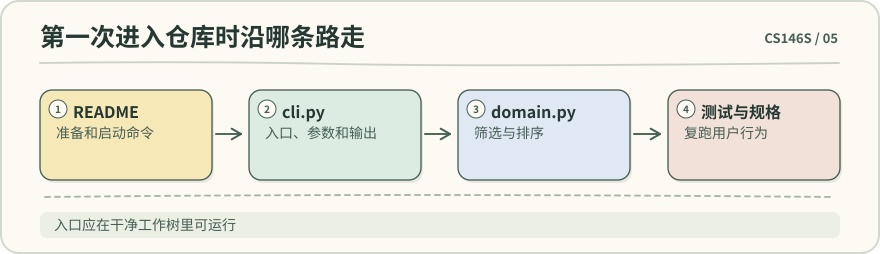
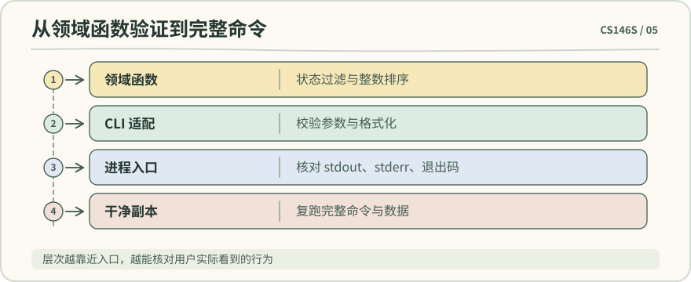

# 第 05 章 · 让代码库适合代理协作

**对应 Fall 2026 第 5 周 · Agent-Ready Codebases**

“我这儿能跑。”你把项目检到新目录，再敲同一条命令，测试立刻说找不到数据文件。原来旧目录里有份上个月手工生成的文件，Git 里从没提交过。人做熟了会绕过去，代理换了环境，只能从这一刻开始猜。第 5 周我们让仓库自己回答“从哪里开始”和“怎样知道改对了”。

10 月 20 日第 9 讲讨论仓库的结构、文档、构建和可验证检查。10 月 22 日第 10 讲的课表来宾是 Factory 的 Eno Reyes。Factory 公开了自己的就绪度框架，本章用它看仓库全貌，再用干净副本做一次实测。 [第 9 讲课件](https://docs.google.com/presentation/d/1yCxocmUrGIN7IrC42WB6NW08PtYYFLe1ombDj3Ay6_8/htmlpresent) · [Factory 的就绪度框架](https://factory.ai/news/agent-readiness)

## 1. 从一个干净副本走进仓库

就绪的仓库允许新来的人找到入口、重建环境、做一处小改动并验证结果。对 Taskboard，可以顺着 README 找到列表规格和启动命令，再从 `cli.py` 跳到 `domain.py`，最后用测试对齐用户能观察到的行为。固定测试数据或在测试中创建临时目录，避免机器上的旧文件影响结果。



| 检查维度 | 需要看到的证据 |
| --- | --- |
| 启动 | 用记录的 Python 版本执行 CLI |
| 导航 | 可以定位 CLI、领域逻辑和规格 |
| 验证 | 测试发现了预期用例，命令有退出码 |
| 环境 | 从干净工作树或副本复跑成功 |
| 失败诊断 | 预置的错误让明确断言失败 |

可以给每项记 0 分（缺失）、1 分（有命令或描述）、2 分（在干净副本里已验证）。比较修复前后时保留原始证据，特别标记阻塞项。总分相同的两个仓库可能有完全不同的上手成本。

Factory 的框架覆盖八个方面。把每项对应到一个常见的失败场景，检查时就容易知道要去哪找证据。下表用的是本书的检查问题。 [Factory 的就绪度框架](https://factory.ai/news/agent-readiness)

| 方面 | 打开陌生仓库时怎样检查 |
| --- | --- |
| 风格与校验 | 能否一条命令找出格式、类型和常见静态错误？ |
| 构建系统 | 干净环境能否按版本化配置重建同一套输入？ |
| 测试 | 能否跑单个相关用例？断言失败会交代实际值吗？ |
| 文档 | README 是否能找到真实入口，提供仍可运行的命令？ |
| 开发环境 | 语言版本、依赖、测试数据和系统组件能否重建？ |
| 代码质量 | 同类功能是否有一致的路径，能否定位现有实现？ |
| 可观测性 | 出错时能否从日志或指标找到任务、错误和版本？ |
| 安全与治理 | 凭据、依赖更新和合并门禁有哪些可核对规则？ |

先修最长的那块等待。如果构建必须从另一个人的目录手拷一份文件，修好依赖入口通常比加十条风格规则更能帮助交付。换到 UE Cook 项目，同样可以问：“设备不联网时能否用已准备的资源跑一条小 Cook？出了错能找到对应平台、引擎提交和首条失败日志吗？”选一条便宜的检查，让冷启动的失败可复现。


## 2. 把列表行为实现成可复跑的 CLI

在实验目录建立 `taskboard/__init__.py`、`taskboard/domain.py`、`taskboard/cli.py` 和 `tests/`。用第 1 章的任务作为种子数据。先在 `domain.py` 里实现这个纯函数。

```python
def list_tasks(tasks, status=None):
    if status not in (None, "open", "done"):
        raise ValueError("invalid status")
    selected = (task for task in tasks if status is None or task["status"] == status)
    return sorted(selected, key=lambda task: task["id"])
```

在 `cli.py` 中用 `argparse` 建立 `list` 子命令，在其下加上 `--status` 并用 `choices=("open", "done")` 校验。调用领域函数后逐条输出，每行使用制表符分隔 ID 和标题。保留默认的参数错误处理，并在模块入口用 `raise SystemExit(main())` 传递退出码。领域测试可直接导入函数，CLI 测试可以用 `subprocess.run` 捕获 stdout、stderr 和退出码。

可以直接使用下面的 `taskboard/cli.py` 进行对照。种子数据故意乱序，方便发现漏掉排序的问题。

```python
import argparse

from .domain import list_tasks

TASKS = [
    {"id": 103, "title": "梳理权限", "status": "open"},
    {"id": 102, "title": "写文档", "status": "done"},
    {"id": 101, "title": "补测试", "status": "open"},
]


def main(argv=None):
    parser = argparse.ArgumentParser(prog="taskboard")
    commands = parser.add_subparsers(dest="command", required=True)
    listing = commands.add_parser("list")
    listing.add_argument("--status", choices=("open", "done"))
    args = parser.parse_args(argv)

    for task in list_tasks(TASKS, args.status):
        print(f"{task['id']}\t{task['title']}")
    return 0


if __name__ == "__main__":
    raise SystemExit(main())
```



在 `tests/test_list.py` 先放进可复跑的验收用例。`sys.executable` 沿用当前 Python，`-X utf8` 让子进程在 Windows 上也用 UTF-8 输出，测试对 stdout、stderr 和退出码分别断言。CLI 使用固定数据，空结果从领域函数入口验证。

```python
import subprocess
import sys
import unittest

from taskboard.domain import list_tasks


class ListTests(unittest.TestCase):
    def run_list(self, *args):
        return subprocess.run(
            [sys.executable, "-X", "utf8", "-m", "taskboard.cli", "list", *args],
            capture_output=True,
            text=True,
            encoding="utf-8",
        )

    def test_open_list_is_sorted(self):
        result = self.run_list("--status", "open")
        self.assertEqual(result.returncode, 0, result.stderr)
        self.assertEqual(result.stdout, "101\t补测试\n103\t梳理权限\n")
        self.assertEqual(result.stderr, "")

    def test_done_list(self):
        result = self.run_list("--status", "done")
        self.assertEqual(result.returncode, 0, result.stderr)
        self.assertEqual(result.stdout, "102\t写文档\n")

    def test_missing_status_lists_all(self):
        result = self.run_list()
        self.assertEqual(result.returncode, 0, result.stderr)
        self.assertEqual(result.stdout, "101\t补测试\n102\t写文档\n103\t梳理权限\n")

    def test_invalid_status_is_an_argument_error(self):
        result = self.run_list("--status", "archived")
        self.assertEqual(result.returncode, 2)
        self.assertEqual(result.stdout, "")
        self.assertIn("archived", result.stderr)

    def test_legal_filter_without_matches(self):
        tasks = [{"id": 102, "title": "写文档", "status": "done"}]
        self.assertEqual(list_tasks(tasks, "open"), [])
```

从实验仓库根目录运行以下两条命令。把 `python` 换成你环境中的 Python 3 命令即可。

```sh
python -m unittest discover -s tests -v
python -X utf8 -m taskboard.cli list --status open
```

看到用例实际被发现才继续。CLI 应分两行返回 101 和 103。随后把任务种子顺序打乱，预期输出保持升序。若测试只断言 ID 集合，即便程序误把 103 打在前面，测试也可能仍然通过。

## 3. 用同一条命令看见一次红和一次绿

在实验副本把 `return sorted(...)` 临时改成 `return list(selected)`，再跑同样的测试。按现在的输入顺序，原本应该先打印 101 的两项用例会变红。记录断言里实际值和预期值，再恢复排序，确认五条全绿。下一章会换一种更隐蔽的错误，让这批现成测试也察觉不到。


## 本章验收

将实验文件提交到本地 Git，在不同位置用 `git clone` 克隆本地仓库。用已记录的命令复跑，至少覆盖全部、open、done、空结果和非法状态。记录用例数、结果和一个修复过的障碍，比如补上明确的测试目录。完成后回跑第 3 章 Skill。


## 对照阅读

- 官方第 5 周作业要为三个开源仓库跑就绪度报告，比较各维度的失败项，并用证据解释共同问题和个别问题。 [官方第 5 周作业](https://github.com/mihail911/modern-software-dev-assignments/blob/master/week5/assignment.md) · [课程推荐演讲](https://www.youtube.com/watch?v=ShuJ_CN6zr4)
- 核对标准库测试发现的参数。 [Python unittest 文档](https://docs.python.org/3/library/unittest.html#test-discovery)

[上一章](../ch04/README.md) · [返回目录](../../README.md) · [下一章](../ch06/README.md)
