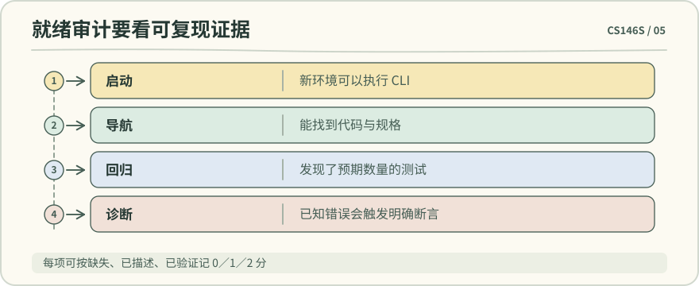
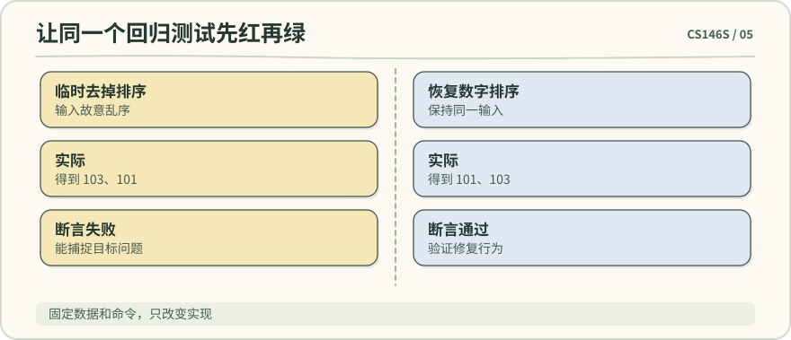
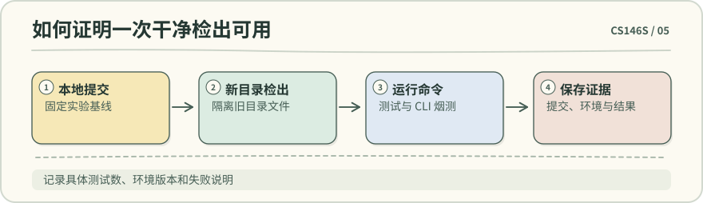

# 第 05 章 · 让代码库适合代理协作

**对应 Fall 2026 第 5 周 · Agent-Ready Codebases**

从新目录检出代码后，测试说找不到数据文件。原来的目录里恰好有一份未提交的数据，开发者早就习惯了它。代理换了环境，第一次执行就把这个隐含前提暴露出来了。

## 1. 从一个干净副本走进仓库

就绪的仓库允许新来的人找到入口、重建环境、做一处小改动并验证结果。对 Taskboard，可以顺着 README 找到列表规格和启动命令，再从 `cli.py` 跳到 `domain.py`，最后用测试对齐用户能观察到的行为。固定测试数据或在测试中创建临时目录，避免机器上的旧文件影响结果。


| 检查维度 | 需要看到的证据 |
| --- | --- |
| 启动 | 用记录的 Python 版本执行 CLI |
| 导航 | 可以定位 CLI、领域逻辑和规格 |
| 验证 | 测试发现了预期用例，命令有退出码 |
| 环境 | 从干净工作树或副本复跑成功 |
| 失败诊断 | 预置的错误让明确断言失败 |

可以给每项记 0 分（缺失）、1 分（有命令或描述）、2 分（在干净副本里已验证）。比较修复前后时保留原始证据，特别标记阻塞项。总分相同的两个仓库可能有完全不同的上手成本。



## 2. 把列表行为实现成可复跑的 CLI

在实验目录建立 `taskboard/__init__.py`、`taskboard/domain.py`、`taskboard/cli.py` 和 `tests/`。用第 1 章的任务作为种子数据。先在 `domain.py` 里实现这个纯函数。

```python
def list_tasks(tasks, status=None):
    if status not in (None, "open", "done"):
        raise ValueError("invalid status")
    selected = (task for task in tasks if status is None or task["status"] == status)
    return sorted(selected, key=lambda task: task["id"])
```

在 `cli.py` 中用 `argparse` 建立 `list` 子命令，在其下加上 `--status` 并用 `choices=("open", "done")` 校验。调用领域函数后逐条输出，每行使用制表符分隔 ID 和标题。保留默认的参数错误处理，并在模块入口用 `raise SystemExit(main())` 传递退出码。领域测试可直接导入函数，CLI 测试可以用 `subprocess.run` 捕获 stdout、stderr 和退出码。

可以直接使用下面的 `taskboard/cli.py` 进行对照。种子数据故意乱序，方便发现漏掉排序的问题。

```python
import argparse

from .domain import list_tasks

TASKS = [
    {"id": 103, "title": "梳理权限", "status": "open"},
    {"id": 102, "title": "写文档", "status": "done"},
    {"id": 101, "title": "补测试", "status": "open"},
]


def main(argv=None):
    parser = argparse.ArgumentParser(prog="taskboard")
    commands = parser.add_subparsers(dest="command", required=True)
    listing = commands.add_parser("list")
    listing.add_argument("--status", choices=("open", "done"))
    args = parser.parse_args(argv)

    for task in list_tasks(TASKS, args.status):
        print(f"{task['id']}\t{task['title']}")
    return 0


if __name__ == "__main__":
    raise SystemExit(main())
```


在 `tests/test_list.py` 放一个从进程入口验证输出的用例。再按规格表补上 `done`、省略参数和非法状态。空结果可以直接给领域函数传入空任务清单。

```python
import subprocess
import sys
import unittest


class ListTests(unittest.TestCase):
    def test_open_list_is_sorted(self):
        result = subprocess.run(
            [sys.executable, "-m", "taskboard.cli", "list", "--status", "open"],
            capture_output=True,
            text=True,
            encoding="utf-8",
        )
        self.assertEqual(result.returncode, 0, result.stderr)
        self.assertEqual(result.stdout, "101\t补测试\n103\t梳理权限\n")
        self.assertEqual(result.stderr, "")
```

在仓库根目录跑：

```sh
python3 -m unittest discover -s tests -v
python3 -m taskboard.cli list --status open
```

看到用例实际被发现才继续。CLI 应分两行返回 101 和 103。随后把任务种子顺序打乱，预期输出保持升序。若测试只断言 ID 集合，即便程序误把 103 打在前面，测试也可能仍然通过。

## 3. 用同一条命令看见一次红和一次绿

先让程序短暂漏掉排序，再运行包含乱序输入的用例。记录最具体的失败断言。恢复排序后从同一入口重跑。这个实验验证了测试能察觉目标回归，也验证了下一位开发者能找到触发它的命令。



## 本章验收

将实验文件提交到本地 Git，在不同位置用 `git clone` 克隆本地仓库。用已记录的命令复跑，至少覆盖全部、open、done、空结果和非法状态。记录用例数、结果和一个修复过的障碍，比如补上明确的测试目录。完成后回跑第 3 章 Skill。



## 对照阅读

- 课程第 5 周包含仓库就绪度、结构、文档与检查。 [Fall 2026 课纲](https://themodernsoftware.dev/) · [课程推荐演讲](https://www.youtube.com/watch?v=ShuJ_CN6zr4)
- 核对标准库测试发现的参数。 [Python unittest 文档](https://docs.python.org/3/library/unittest.html#test-discovery)

[上一章](../ch04/README.md) · [返回目录](../../README.md) · [下一章](../ch06/README.md)
