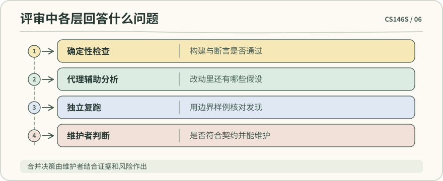
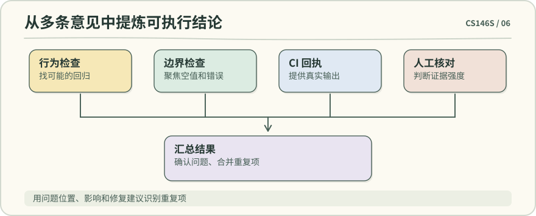

# 第 06 章 · 用代理辅助代码评审

**对应 Fall 2026 第 6 周 · Agentic Code Review**

一份补丁把排序从数字 ID 改成字符串 ID。用样例 101、102、103 跑一遍，输出看起来照旧。放进去 ID 2 和 10，字符串排序会把 10 放前面。评审要把“排序可疑”的直觉转成维护者可以复跑的证据。

## 1. 从差异追到使用者可以看到的回归

让评审代理读需求、基线、差异和附近的测试。检查差异中的假设，必要时追踪调用的函数。给人看的评论写清位置、触发条件、预期和实际输出。和代码风格建议有关的评论可以与行为错误分开标注。

> `taskboard/domain.py` 的排序键把数字转成了字符串。输入 ID 2 和 10 的两条 open 任务，输出变成 10、2。列表规格要求数值升序，预期为 2、10。建议继续以整数 ID 排序，并补一个不同位数的回归用例。

## 2. 将不同类型的检查交给合适的执行者

格式、构建和回归断言由确定性工具执行。代理擅长从差异追踪假设、列出需要核对的边界例，以及汇总可能的遗漏。维护者判断产品契约、架构取舍和风险是否接受。在并行评审里，可以专题分工，然后按实际问题和同一处修复建议去重。

同一模型的两个会话可能犯相同错误。让评审在新上下文中拿到规格、差异和测试入口，并复跑至少一个独立选出来的输入。对于声称已验证的结论，核对模型是否真的拿到了命令输出。

## 3. 衡量评论是否帮人更快做决定

准备一份正常差异和一份带排序回归的差异。先请代理评单独的 diff，再补上规格和测试入口重跑；同时保留两次结果。统计真实问题、误报、重复项和人工复核的用时。如果关键问题没被找到，记录漏报，它应与确认的评论一起进入复盘。

## 本章验收

将数值排序换成字符串排序放在实验分支或临时副本中。用测试或最小输入复现，写出一条带证据的评审意见，再恢复数值排序并重跑。用同一套样本记录两种评审输入的结果，即使有一轮评论为空也保留记录。

## 对照阅读

- 来自工程团队的评审编排案例。 [Cloudflare 工程博客](https://blog.cloudflare.com/ai-code-review) · [Fall 2026 课纲](https://themodernsoftware.dev/)

[上一章](../ch05/README.md) · [返回目录](../../README.md) · [下一章](../ch07/README.md)
