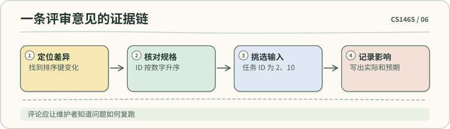
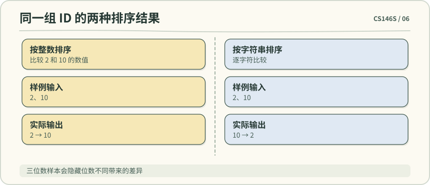
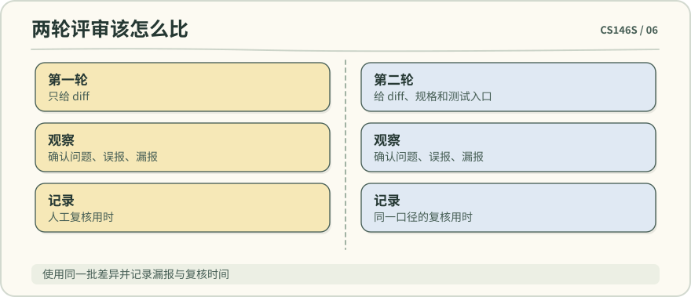

# 第 06 章 · 用代理辅助代码评审

**对应 Fall 2026 第 6 周 · Agentic Code Review**

第 5 章刚把测试跑绿。这次收到的改动只有一行，排序键从数字 ID 换成了字符串 ID。101、102、103 的打印顺序一模一样，五条测试也照样绿。换上编号 2 和 10 的两条任务再跑一次，10 跑到了 2 前面。评审的工作从这个反例开始。

10 月 27 日第 11 讲讨论评审为什么成了瓶颈、怎样分层和怎样评估。10 月 29 日第 12 讲的课表来宾是 Cognition 的 Silas Alberti。本章按公开课件和工程案例练习从证据到评论。 [第 11 讲课件](https://docs.google.com/presentation/d/1u8WYtFj0O9yc4H4JX9D4URYKhDzvrAGKLzn38DXSrak/htmlpresent) · [Cloudflare 工程案例](https://blog.cloudflare.com/ai-code-review)

## 1. 从差异追到使用者可以看到的回归

让评审代理读需求、基线、差异和附近的测试。检查差异中的假设，必要时追踪调用的函数。给人看的评论写清位置、触发条件、预期和实际输出。和代码风格建议有关的评论可以与行为错误分开标注。

先跑旧测试，了解它们覆盖什么。然后走过差异下游，确认排序列表被 CLI 原样打印。给 `list_tasks` 两条记录 `{"id": 2, "status": "open"}` 和 `{"id": 10, "status": "open"}`，对返回的 ID 做一次精确的顺序断言。`set(ids) == {2, 10}` 在错误实现上也会通过，因为集合丢掉了顺序。用 `ids == [2, 10]` 才能锁住用户看到的行为。

> `taskboard/domain.py` 的排序键把数字转成了字符串。输入 ID 2 和 10 的两条 open 任务，输出变成 10、2。列表规格要求数值升序，预期为 2、10。建议继续以整数 ID 排序，并补一个不同位数的回归用例。

## 2. 将不同类型的检查交给合适的执行者

格式、构建和回归断言先交给确定性工具。代理读 diff 和附近的实现，找证据并提出边界输入。维护者确认产品契约、架构取舍和影响范围。一行文档改动适合走轻路径。碰到权限、兼容或发布行为时，多一个独立验证入口和明确的人工评审。课程展示了把安全、质量等检查分给专门评审器，再由汇总步骤合并和过滤意见的架构。 [第 11 讲课件](https://docs.google.com/presentation/d/1u8WYtFj0O9yc4H4JX9D4URYKhDzvrAGKLzn38DXSrak/htmlpresent)

同一模型的两个会话可能犯相同错误。让评审在新上下文中拿到规格、差异和测试入口，并复跑至少一个独立选出来的输入。对于声称已验证的结论，核对模型是否真的拿到了命令输出。

给评审会话一份可直接使用的任务。比如“核对这个补丁是否改变 `docs/list-spec.md` 的任一行为。先列修改的入口和可能受影响的测试。每个发现写出文件位置、触发输入、候选结果、预期和影响。能用本地命令验证就给出输出。存在疑点但没观察到失败时，放进待核对项”。拿到结果后看它有没有提出新输入，还是仅把作者已经执行的命令复述了一遍。

两位评审器都提到 `domain.py` 的排序键时，留下证据最完整的一条。再核对评论指向的提交。如果作者已经改回整数排序，旧评论只能当工作记录。用以下格式给评审器交接：“基线及候选 SHA → 相关规格 → 检查范围 → 发现（文件、触发输入、影响、证据）→ 未验证的问题”。候选更新后重新跑证据。

## 3. 衡量评论是否帮人更快做决定

准备一份正常差异和一份带排序回归的差异。先请代理评单独的 diff，再补上规格和测试入口重跑；同时保留两次结果。统计真实问题、误报、重复项和人工复核的用时。如果关键问题没被找到，记录漏报，它应与确认的评论一起进入复盘。

评估时用同一批有真值的差异，包含无缺陷样例，先合并重复评论。假设样本有 5 个已知问题，代理报出 7 个独立候选，人工确认其中 4 个真正命中。精确率是 4／7，召回率是 4／5。余下 3 个候选会消耗复核时间，漏掉的 1 个问题要按风险评估。用每份改动花掉的复核分钟数和问题等级一起决定流程是否值得采用。

小实验至少做三份差异。第一份只改帮助文案，当无缺陷样本。第二份引入字符串排序，检查是否有 `2` 和 `10` 的证据。第三份把非法参数错误改成成功退出，检查能否沿 CLI 的 stdout、stderr 和退出码找到影响。每份差异用相同的模型和预算各评两次，只改变是否提供规格与验证入口。这样发现差异时，能回头定位是输入变了还是评审器偶然波动。

第 6 周官方作业另有一个可量化的工程场景。学生要在 Switchyard webhook 系统里优化代理解决故障的正确率与 token 成本，用未见过的故障验收配置。把同样的思路用在评审上，保留一批没参与调参的历史差异，再比模型、上下文长度和人工复核成本。 [官方第 6 周作业](https://github.com/mihail911/modern-software-dev-assignments/blob/master/week6/assignment.md)

## 本章验收

将数值排序换成字符串排序放在实验分支或临时副本中。用测试或最小输入复现，写出一条带证据的评审意见，再恢复数值排序并重跑。用同一套样本记录两种评审输入的结果，即使有一轮评论为空也保留记录。

## 对照阅读

- 来自工程团队的评审编排案例。 [Cloudflare 工程博客](https://blog.cloudflare.com/ai-code-review) · [Fall 2026 课纲](https://themodernsoftware.dev/)

[上一章](../ch05/README.md) · [返回目录](../../README.md) · [下一章](../ch07/README.md)
