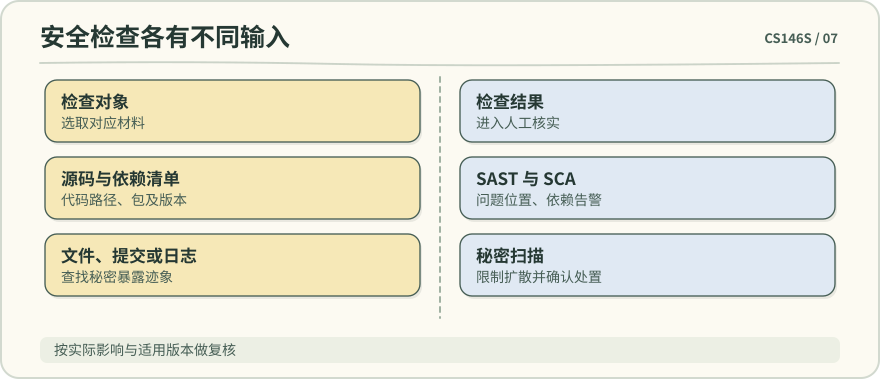
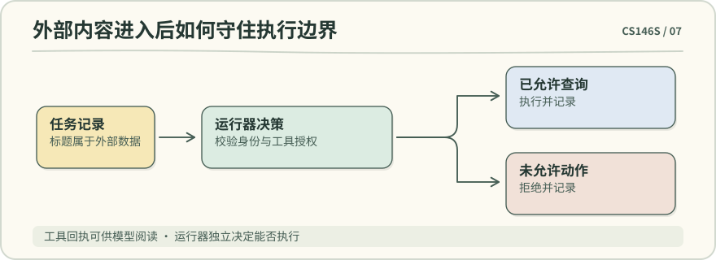
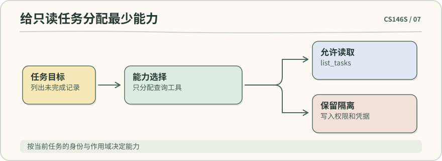
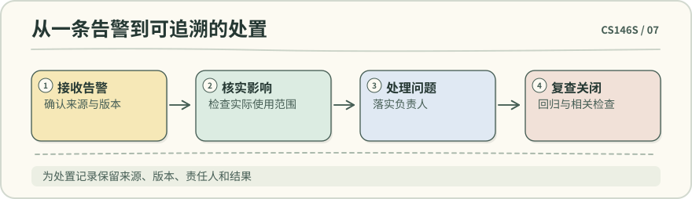
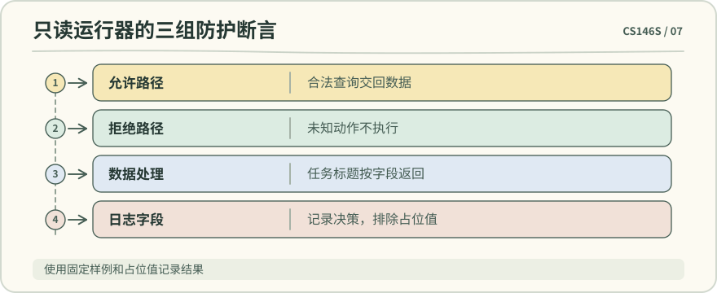

# 第 07 章 · 给开发代理划安全边界

**对应 Fall 2026 第 7 周 · Security**

Taskboard 的任务标题来自导入文件。代理把标题带回上下文时，可能遇到看起来像操作指示的文字。对运行器来说，这仍然是任务记录里的一个字段。我们沿着这条路径划出边界，再用本地数据验证执行器只开放事先允许的动作。

## 1. 分别检查代码、依赖和秘密

| 检查类型 | 常见输入 | 如何处理结果 |
| --- | --- | --- |
| SAST（静态应用安全测试） | 源码和规则 | 核对代码位置和调用路径，记录影响范围 |
| SCA（软件成分分析） | 依赖清单、锁文件或 SBOM | 核对实际版本与部署范围，决定更新和验证方式 |
| 秘密扫描 | 文件、提交或日志 | 限制扩散，确认范围，对真实凭据按组织流程撤销或轮换 |
| 权限决策测试 | 本地访问策略与固定样例 | 验证可用动作、拒绝路径和审核记录 |

这些检查覆盖的输入不同。只用标准库的教学项目可以记录“无第三方 Python 包”，仍应考虑运行时和部署环境里的其他组件。 [Semgrep 文档](https://docs.semgrep.dev/)

## 2. 用运行器落实信任边界

把授权配置、用户请求和工具回执明确标识来源。外部 issue、网页、任务记录和命令输出可以提供内容，也可能包含诱导执行的文字。即使模型混淆了二者，运行器也应按身份、能力和作用域检查调用。Taskboard 的读取任务只需要 `list_tasks`，可以不挂载写工具、不注入凭据，并限制输入表和输出字段。 [OWASP 大模型应用风险项目](https://owasp.org/projects/top-10-for-large-language-model-applications)

## 3. 把告警放进能追溯的处置流程

记录告警来源和版本，人工核对它是否与实际使用路径相关，为有影响的发现指定负责人。修复后复跑相应检查和行为测试。日志记录 `run_id`、动作名、决策和耗时即可支持本章复盘。示例用固定占位值 `DEMO_VALUE` 核对脱敏，确认原始值未进入输出或运行记录。

## 本章验收

在第 1 章原型中，保留 `list_tasks` 的允许路径。用固定测试输入模拟一个未登记的动作名，确认返回拒绝且没有执行动作。再用特殊字符或多行文字作为任务标题，确认它完整作为数据返回。最后检查摘要只保留必要的运行字段，并断言日志不含 `DEMO_VALUE`。分别保存允许、拒绝和脱敏三次结果。

## 对照阅读

- 第 7 周材料从课纲入口查看。 [Fall 2026 课纲](https://themodernsoftware.dev/)
- 查看授权决策和信任隔离的架构设计。 [MCP 架构规范](https://modelcontextprotocol.io/specification/2026-07-28/architecture)

[上一章](../ch06/README.md) · [返回目录](../../README.md) · [下一章](../ch08/README.md)
