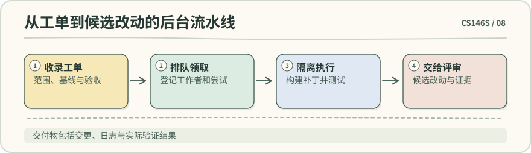
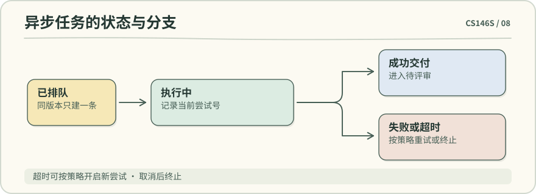
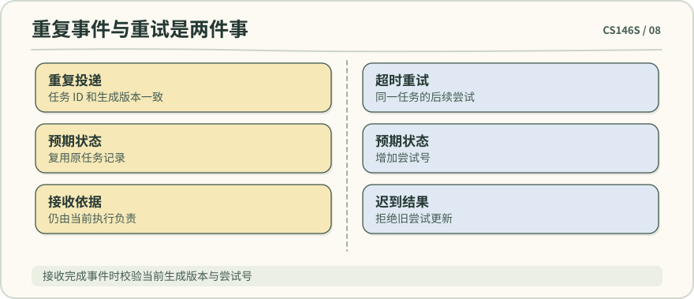
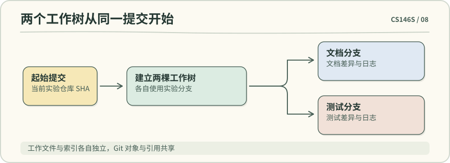
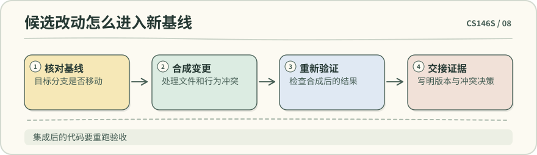

# 第 08 章 · 后台代理与异步开发

**对应 Fall 2026 第 8 周 · Background Agents**

下班前你扔了两张工单给后台代理，一张补文档，一张补排序测试。回来见到两个 PR，接着又冒出一个。原来工单平台等超时后重发，两个工作者先后处理了同一个任务。再看测试，两个 PR 都是各自基线上的绿灯。你该先合哪一个？已经超时的执行还可以交付吗？

11 月 10 日第 15 讲对应异步启动、并行代理和工单交付。11 月 12 日第 16 讲的课表来宾是 Cloudflare 的 Rajesh Bhatia。Stripe 的公开实践提供了一个可查的实现例子，通常由 Slack 或内部系统发起，代理在开发环境中执行，最终交出供人工评审的 PR。下面用 Taskboard 搭出这条路径的最小版本。 [Fall 2026 课纲](https://themodernsoftware.dev/) · [Stripe Minions 工程案例](https://stripe.dev/blog/minions-stripes-one-shot-end-to-end-coding-agents)

## 1. 从工单到评审，保存每次状态变化

把任务、起始提交、可改范围、验证命令和输出位置放入任务记录。工作者领取任务时登记尝试号。完成后附上变更、日志和测试结果，再移动到待评审。超时或取消时保留最后一次执行证据。收到迟到的完成事件时，用当前状态和尝试号判断是否接受。

第 1 章的前台循环可以随时问人。后台运行需要一份独立可读的委托，并在权限不足、规格有歧义或预算用尽时留下明确状态。可以把流程拆成三层。调度器管领单、限额和状态。工作者在隔离环境里修改与验证。交付步骤创建或更新候选 PR，写清哪个提交通过了哪些检查。连起三层靠的是任务记录和可回查的工件。





| 字段 | 示例 |
| --- | --- |
| 任务与生成版本 | `TB-08`，generation 1 |
| 起始提交 | 实验仓库当前提交 SHA |
| 本次执行 | attempt 1 |
| 允许范围 | `tests/` |
| 验证 | `python -m unittest discover -s tests -v` |
| 交付 | 补丁、实际测试结果、待人工处理事项 |

同一工单同一版本重复送达时，应落到同一逻辑任务。重试增加尝试号，重新下发修改后的需求则增加生成版本。状态更新应防止并发领取以及旧尝试覆盖较新的结果。

把新工单的唯一键设为 `(task_id, generation)`。两个工作者同时领取时，用数据库事务或原子更新检查“仍待领取”，只有一个能把它改成执行中。完成时也带上 `attempt`，检查它仍是当前持有者。下面的迟到回执仍值得留作诊断，提交过程只接受当前尝试的工件。更新外部 PR 时也找同一任务的候选，避免一次网络重试发出两份。



用下面的事件顺序检查状态更新。尝试 1 已超时，随后才交来结果，因此记录应继续指向尝试 2。

| 收到的事件 | 事件处理后的记录 |
| --- | --- |
| 投递 TB-08 第 1 版两次 | 一条任务，待领取 |
| 工作者甲领取后超时 | 尝试 1 超时，任务回到队列 |
| 工作者乙领取并开始 | 尝试 2 执行中 |
| 工作者甲补交结果 | 尝试 2 仍在执行，记录一条过期回执 |
| 工作者乙提交变更和验证记录 | 尝试 2 待评审 |

重试前要看失败类型。短暂的执行机故障可以换环境重试一次。规格冲突或缺少权限应暂停交给负责人。测试实际失败可以在预算内修一次，报告失败断言和最后补丁。所有任务一起跑还会争用 CI 和模型额度，给工作队列设并发上限和每次预算，先用少量独立任务观测等待时间。

## 2. 从同一基线创建两个工作树

在实验仓库根目录执行，先确保已有一次提交，且目标分支、目录此前未使用。

```sh
git worktree add -b lab/docs ../taskboard-lab-docs HEAD
git worktree add -b lab/tests ../taskboard-lab-tests HEAD
git worktree list
```

两个工作树分别接文档任务和测试任务。各自在自己的目录运行测试并保存提交 SHA。Git 工作树隔离当前检出的文件和索引，同时共享仓库数据与引用。独立执行环境还需要另外处理凭据、网络和文件权限。 [Git worktree 文档](https://git-scm.com/docs/git-worktree)

先让两份补丁改不同文件，再让它们各自修改同一句文档。第一组看出并行如何减少等待，第二组可以观察冲突何时被发现。文档和代码分别改动还有一种隐蔽的冲突，Git 能自动合并，文档却给了和代码不一致的调用例子。需要在集成结果里重新跑命令或核对规格。



## 3. 合并之前重新核对基线

工作树隔开了并行编辑，合并时仍可能遇到同一个文件或同一业务行为的冲突。先检查目标分支是否移动，再在集成结果上复跑测试。需要人工决定时，交接中指出两个冲突目标和预期契约。

交接包至少回答四个问题。它从哪个提交开始？最后哪个提交通过了检查？看过哪些实际输出？还有什么要人决定？候选提交、运行日志和工单号可用来回查。主分支已经移动时，把候选放到当前基线上验证，才知道之前的绿灯能否用于现在的合并判断。



## 本章验收

先用纸面表格或本地 JSON 记录同一任务的两次投递，核对只出现一个逻辑任务。再模拟第一次尝试超时、第二次开始后第一次才提交结果，核对最终记录仍指向当前尝试。用两个工作树改同一行文档，在实验分支观察冲突并解决。最后提交一份带基线、尝试号、差异路径、测试结果和交付状态的记录。

## 对照阅读

- 从内部请求到候选 PR 的后台代理案例。 [Stripe 工程博客](https://stripe.dev/blog/minions-stripes-one-shot-end-to-end-coding-agents) · [Fall 2026 课纲](https://themodernsoftware.dev/)
- Stripe 用称为 blueprints 的编排结合固定步骤与模型步骤，开发环境和检查都复用面向工程团队的基础设施。 [Stripe 实现细节](https://stripe.dev/blog/minions-stripes-one-shot-end-to-end-coding-agents-part-2)

[上一章](../ch07/README.md) · [返回目录](../../README.md) · [下一章](../ch09/README.md)
