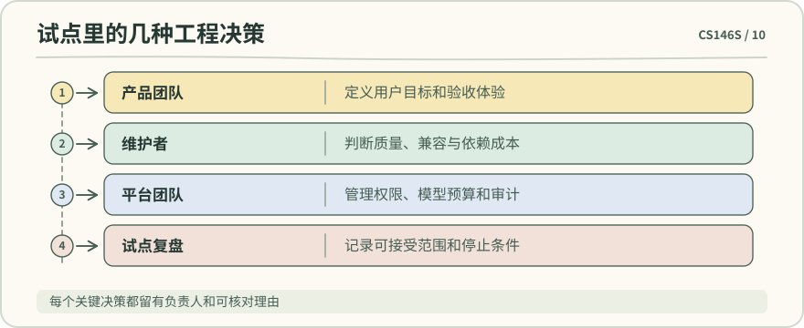

# 第 09 章 · 让团队用得起、接得住代理

**对应 Fall 2026 第 9 周 · Building an AI-Native Team**

星期一，代理给团队一口气开了八个 PR。列表筛选改得挺快，维护者却花了半天确认每个 PR 的范围、复跑测试、合并重复方案。星期五统计时，“生成补丁的平均用时”明显下降，“工单到合并的时间”却没缩短。改进哪一段，要看团队实际卡在哪里。

本周课表是两场来宾课，11 月 17 日第 17 讲为 Elad Gil，11 月 19 日第 18 讲为 Replit 的 Amjad Masad。下面从课纲的团队采用主题出发，用 Taskboard 展开试点练习。MCP 门户、模型网关与软件工厂放在第 10 章，跟随 12 月的具体讲次。 [课程官网](https://themodernsoftware.dev/) · [Fall 2026 讲次对照](https://romanrose.github.io/llm_learn/generated/courses/cs146s-fall26/)

## 1. 从团队每天都在做的一类任务开始

先翻几个最近做完的任务。文档修正通常改动小，排序回归有明确输入输出，修改默认行为则影响旧调用方。把三类任务拆开统计，你才知道哪种适合代理独立准备候选，哪种需要产品先决定。选一个可逆、有测试、有人能评审的任务族起步，如“Taskboard 的列表回归用例和相关文档”。

| 阶段 | 代理能交付什么 | 人做什么 |
| --- | --- | --- |
| 跟跑 | 按同一张工单提出计划或评审意见 | 人仍走原流程，核对建议命中率和漏掉的边界 |
| 试点 | 处理批准过的低风险任务，交付候选补丁与测试记录 | 维护者按同一个规格验收，记录复核耗时和返工原因 |
| 扩大 | 接受少量新任务类型或更多仓库 | 先补对应验收，定权限和升级路径，再按各类型复测 |

这些步骤也适合个人做。比如在 Flutter 教学 App 中，先让代理处理英语教材资源的清单校验，再打开一节课在设备上走完实际播放。有了可复跑的检查，才开始交付完整课程改动。需要路线和内容判断的任务，可以先让它整理候选和证据。

Replit 产品文档里的任务板是一个公开的对照例子。它能显示代理把工作分成哪些部分、什么正在后台运行、哪些已经完成。自己设计试点时，把状态再落到工件上。“完成”的任务要能点到补丁和验证记录，“等待”的任务要能找到负责人和缺少的信息。 [Replit Agent 任务板文档](https://docs.replit.com/references/agent/task-board)

## 2. 用一张表说清谁能做、谁来验

产品或需求方写清用户期望和边界例。仓库维护者决定代码怎么落地、哪些测试是合并条件。平台维护者管理可用工具、预算和审计记录。一个人可以兼多个角色，起码在试点记录里写清每次决定由谁作出，以及遇到歧义时找谁。权限执行沿用第 7 章的做法，后台任务继续保存第 8 章的基线和尝试号。

Git 的合并权限留给维护者。代理可以在自己的分支准备补丁，并上传与候选提交对应的结果。过滤契约有争议时由需求方确认，分支验证失败时交给该次改动的维护者。把“卡住时跟谁说”写进工单，比加一段“请更努力解决”更能推进工作。

## 3. 度量从接单到交付的整段路

给试点拿一份基线。用相近难度的工单记录完成数量、接单到合并的时间、人工投入、返工和发布后问题。等待 CI、等待用户答复和实际占用人工的时间各记一栏。举个虚构例子，同一批十张工单，旧流程人工投入 300 分钟，新流程投入 180 分钟，但两轮最后完成分别是 10 张和 8 张。每个完成任务的人工投入从 30 分钟降到 22.5 分钟，还要检查剩下两张为什么没有结束，以及同类任务后续是否也能完成。

| 观察到的信号 | 可以先查什么 |
| --- | --- | --- |
| 初稿很快，PR 等待更久 | 是否把负担移给评审者？能否逐个任务交付，或把重复评论合并？ |
| 相似任务反复卡在同一入口 | README、规格、Skill 与 CI 是否给出同一条可用的验证路径？ |
| 平时效果稳定，跨模块改动大量返工 | 按任务规模分开看，扩大权限前先检查规格和依赖关系 |
| 合并更快，发布后回归增加 | 检查发布与回滚的证据，从失败中补一个可复跑的反例 |

## 本章验收

1. 从 Taskboard 挑文档、边界测试和修改默认筛选三种工单，逐个写明是否适合试点，谁有权修改，哪些检查必须有证据。
2. 用同一批样例各模拟一次原有流程与代理流程。统计交付时间、人工复核、完成率和遗漏。把工单到结束的时间及未完成原因一起留下。
3. 写下是否扩大试点，以及什么情况应暂停。给下一章留两份输入，一份工具权限需求，一份团队现有的验收样例。

## 对照阅读

- Fall 2026 第 9 周来宾与第 10 周讲次安排。 [课程官网](https://themodernsoftware.dev/) · [讲次索引](https://romanrose.github.io/llm_learn/generated/courses/cs146s-fall26/)

[上一章](../ch08/README.md) · [返回目录](../../README.md) · [下一章](../ch10/README.md)
