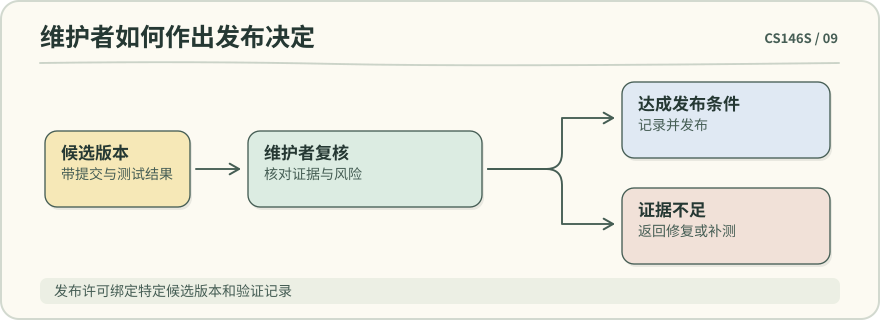
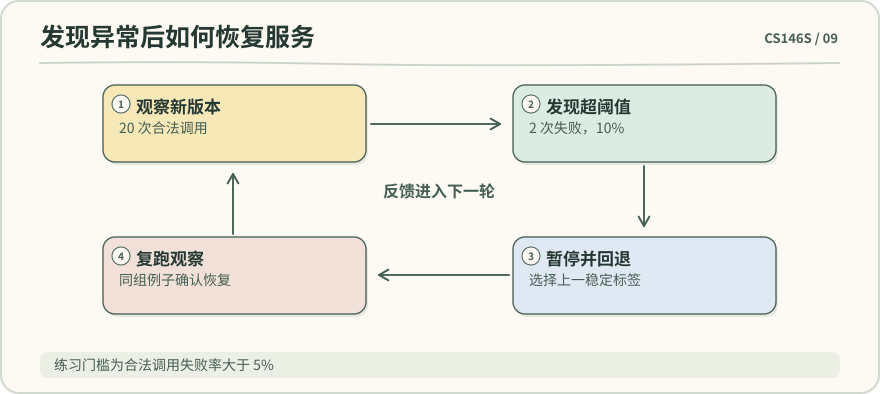

# 第 09 章 · 把开发流程做成软件工厂

**对应 Fall 2026 第 9 周 · The Software Factory**

到这里，任务板已经有规格、测试和候选补丁。如果每回还要靠人记住先跑哪条命令、何时看发布结果、出了问题该找谁，发现与交付之间仍有断点。软件工厂把这些步骤连成持续运行的交付流程，每次状态变化都有证据和负责人。

## 1. 把工单、验证和发布放进同一条流水线

把需求对应到已版本化的规格，把实现对应到提交，把测试对应到运行记录，再把发布对应到可回退的版本。每个阶段标清输入、输出、失败处理和负责人。即使一部分阶段由代理执行，也可以按同样的状态流回放。

Taskboard 仍在本地。我们用 Git 标签或纸面版本号代表发布，用固定运行记录代表观察窗口。初始训练门槛设为每个候选都通过第 2 章的行为检查，发布决策由同学扮演的维护者签字。

## 2. 观察发布和代理本身

发布后观察用户命令是否成功、失败是否集中在某一版本，同时跟踪代理任务的失败类型。**日志**记录某次动作和错误，**指标**聚合成功数、耗时和分布，**追踪**把一次任务从领取、工具调用到交付连起来。用统一的 `run_id` 和提交 SHA 做关联，避免把不同版本的数据混在一起。 [OpenTelemetry 信号概念](https://opentelemetry.io/docs/concepts/signals/)

演练中约定每个版本检查 20 次合法命令，失败率大于 5% 则暂停并回退到上一标签。两次失败是 10%，达到触发条件。非法参数退出 2 属于已约定行为，应从合法命令失败率的分母和分子同时去掉。回退后复跑同组例子，确认恢复，再决定下一步调查。

一条桌面演练记录可以长这样。三条事件都附上实际练习中使用的版本号和证据路径。

| 事件 | 操作者 | 当时证据 |
| --- | --- | --- |
| 暂停候选版本 | 发布负责人 | 合法命令失败 2／20，错误集中在新版本 |
| 回退到上一稳定标签 | 发布负责人 | 回退记录指向原标签和新标签 |
| 复测同样的合法命令 | 验证者 | 记录 20 次结果与退出码，确认是否恢复 |

## 3. 让流程从失败样例中学习

保留一组固定评估任务，例如不同位数排序、空结果处理和 stderr 格式。每次换代理版本、运行提示或工具配置时，用同组输入对照结果。评估记录可包含通过数、执行成本、耗时和人工复核用时。若发生发布失败，把暴露出的缺口加入测试或评估集，经评审后更新流程。

## 本章验收

为两个候选版本各写一条状态记录。第一条在回归测试失败时停在门禁。第二条假定发布前通过，发布观察窗口记录了 20 次合法调用和 2 次失败。写出暂停、回退、复测三条事件并标明操作者和版本。最后补一个可以更早抓住该问题的检查。

## 对照阅读

- 工单到 PR 的工程示例与课程工厂主题。 [Warp 示例](https://github.com/warpdotdev/warp-factory-examples/tree/main/examples/02-sdlc-issue-to-pr) · [Fall 2026 课纲](https://themodernsoftware.dev/)

[上一章](../ch08/README.md) · [返回目录](../../README.md) · [下一章](../ch10/README.md)
