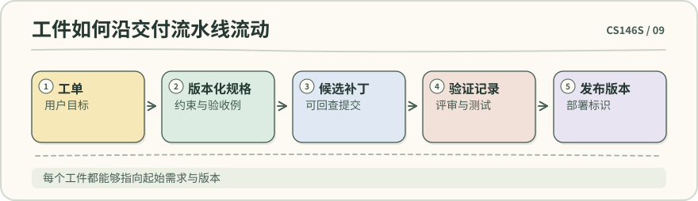
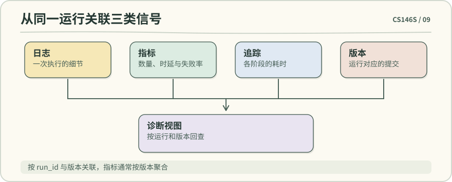
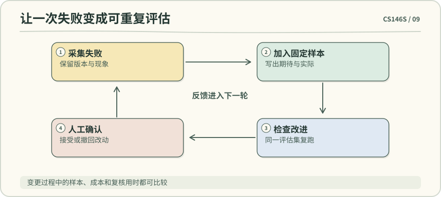

# 第 10 章 · 从团队接入到软件工厂

**对应 Fall 2026 第 10 周 · The Software Factory + The Future**

**课程预习**　截至 2026 年 11 月 26 日，12 月 1 日第 19 讲和 12 月 3 日第 20 讲仍在课表预告中。前者涉及大团队里的工具接入、模型网关和成本，后者计划讨论能持续运行和改进的软件工厂。以下用公开工程资料和 Taskboard 预先演练。 [Fall 2026 课纲](https://themodernsoftware.dev/) · [讲次索引](https://romanrose.github.io/llm_learn/generated/courses/cs146s-fall26/)

产品同事只想问“还有几个任务没完”，工程同事准备把筛选改动发给试用用户。如果两个人的代理启动时收到相同工具和同一个高成本模型配置，查询会话也能看见自己用不上的写工具，团队还要为简单问题付不必要的费用。接着把镜头拉远。代理写完补丁以后，谁能把它推到生产？同一批试用用户连续失败时，系统怎样停下来？

## 1. 在组织内统一管理工具接入

MCP 门户是组织接入模式，可以集中发现工具、核对身份、分配权限、记录调用。Taskboard 试点中，产品角色只能请求列表和统计。工程角色可额外读取测试结果，提交仍进入现有评审流程。每次调用都应根据当前身份和工具作用域作决策。 [Cloudflare 企业 MCP 架构](https://blog.cloudflare.com/enterprise-mcp)

从用户端追一次请求。产品角色打开代理，完成组织登录，门户按身份给出可见的工具。模型选中 `list_tasks`，门户或下游服务在本次调用再查身份和项目范围。工程角色能读本仓库的测试结果，也可以在有授权的工作区提交候选。写入生产由发布流程控制。发现时过滤工具能减少模型上下文，调用时校验能处理权限变更、过期缓存和手工构造的请求。

| 角色 | 平常要用的能力 | 验收一个边界例 |
| --- | --- | --- |
| 产品 | 读取已授权项目的任务和统计 | 查别的项目时返回明确拒绝 |
| 工程 | 读代码与测试结果，在隔离分支准备候选 | 当前任务的权限止于候选分支 |
| 发布负责人 | 查看门禁，从已通过的候选中批准发布和回退 | 未通过验证的提交无法发布 |

## 2. 让模型路由逐步接受评估

模型网关负责接收模型请求、执行路由与预算策略，并收集可观测数据。试点可以先把简单任务交给低成本模型，只在质量门槛无法满足且预算允许时尝试另一条路线。固定模型版本和测试集，比较成功率、延迟、调用费用和人工复核成本。应记录回退原因，按任务类型看结果。 [Cloudflare AI Gateway 文档](https://developers.cloudflare.com/ai-gateway/)

门户管代理**能做什么**，网关管模型请求**走哪条路**。同一个模型在不同任务上的表现可以差很远。把快速查找、普通代码修改和跨模块排错分开判分。对快速查找，可以先用简单模型，答案缺少证据时由宿主触发复查。跨模块排错可以试能力更强的模型，给每次任务设预算。无论选哪条路，都保留输入类别、模型版本、耗时、调用费和实际结果。若模型响应失败也要计入开销。

| 教学样本 | 评估通过 | 调用费用 | 人工复核 | 每个通过任务的成本 |
| --- | ---: | ---: | ---: | ---: |
| 路线 A，20 个任务 | 16 | ¥12 | 40 分钟 | ¥2.00 |
| 路线 B，同 20 个任务 | 19 | ¥24 | 20 分钟 | 约 ¥1.79 |

这里把人工时间按每分钟 ¥0.50 折算，再将调用和复核费用总和除以通过的任务数。表格使用虚构数据。若试点要求通过率至少 90%，路线 B 达标。项目还应事先约定最大成本、等待时间和必须人工复核的任务级别。

## 3. 把工单、验证和发布连起来

软件工厂把代理能做的工作接进一条持续运行的工程流程。Taskboard 中，一个工单指向已确认的规格，后台执行交出候选提交，CI 跑该提交的行为检查。维护者看评审和测试证据，决定是否发布。发布后，观察窗口拿实际命令结果验证。这里用本地 Git 标签或纸面版本号当发布记录。

| 关口 | 看哪份信息 | 通过或停止时留下什么 |
| --- | --- | --- |
| 接单 | 工单和规格版本、任务范围、一组可复跑的输入 | 任务 ID、基线、负责人与限额 |
| 验收候选 | 候选 SHA、确定性测试、相关评审 | 实际结果。失败时记录具体断言，交给维护者处理 |
| 发布 | 通过的候选及回退目标、批准人 | 版本、时间、批准记录，进入观察窗口 |
| 观察 | 合法命令结果、错误率、候选版本和基线 | 保留、暂停或回退决定，以及复测证据 |

上一章的八个候选 PR 可以排成有上限的队列。单个代理补丁通过后进入候选，测试失败则停在验收关口。修改默认筛选涉及产品契约时，即使实现能跑，负责人也要确认旧调用方的兼容做法。工厂自动维护工件流转和验证记录，具体的交付决定由相应的权限与规则控制。 [Warp 工单到 PR 的公开示例](https://github.com/warpdotdev/warp-factory-examples/tree/main/examples/02-sdlc-issue-to-pr)

## 4. 让失败变成下一次运行的输入

**日志**回答某次执行发生了什么，例如一条失败命令及退出码。**指标**回答问题有多常见，例如最近一批合法命令的失败比例。**追踪**把工单、后台尝试、CI 和生产观察关联起来，便于顺着一次执行回查。用 `run_id`、任务 ID、候选 SHA 和发布版本做关联，避免误把旧版本的失败记在新版本。 [OpenTelemetry 信号概念](https://opentelemetry.io/docs/concepts/signals/)

桌面演练先定门槛。每个候选检查 20 次合法命令，失败比例大于 5% 时暂停并回退。新版失败 2 次，比例 10%。非法参数退出 `2` 已写入规格，把这类调用放进另一个指标。发布负责人记录出问题的版本和稳定版本，做回退后用同一批输入重测。确认恢复后，回到最早能识别这次回归的关口，补测试、路由评估或工具规则。

比如后续发现两次失败都来自 ID 位数不一致。把 `2`、`10` 加到固定回归集。下一次换模型、上下文模板或工具权限，用同一套样本比较通过数、调用费、复核时间和错案。团队可以评审流程变更的证据，再逐步启用。每条改动都准备一个能看出改善或退步的输入，才谈得上持续改进。

## 结课演练

1. 以列表筛选为例，把规格、测试、评审意见、运行记录和两次发布演练串成一条可追溯链。
2. 为产品与工程角色各填一个工具权限表，明确批准人、访问范围和审核记录。
3. 用同一套样本比较两条模型路线。记录成本、通过率和复核结论，说明接受哪条试点路线及停止试点的条件。
4. 演练两个版本。A 在 CI 阶段失败，记录被拦下的断言。B 发布后在合法命令中失败 2／20，记录暂停、回退和复测。让另一位读者从交接记录找到规格、发布版本和可复跑的反例。

[上一章](../ch09/README.md) · [返回目录](../../README.md)
