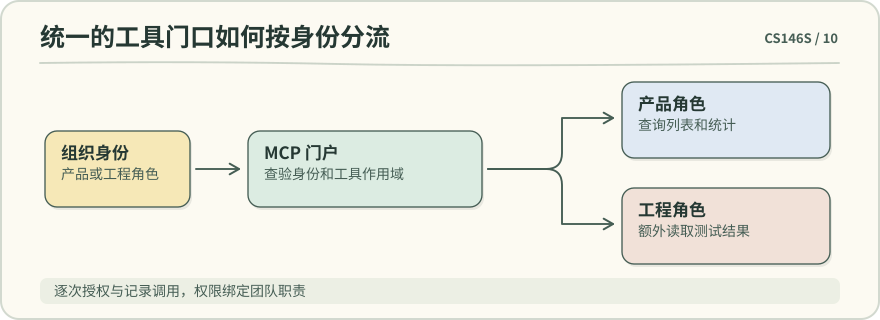
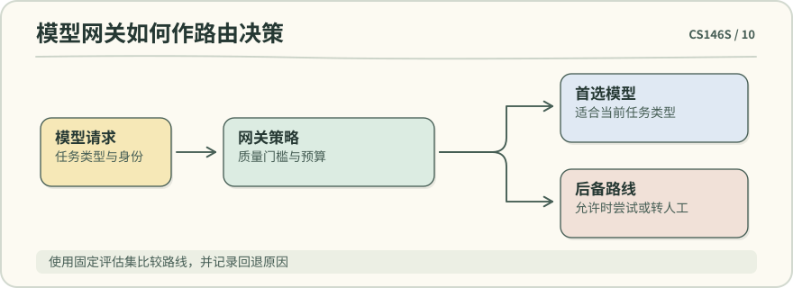
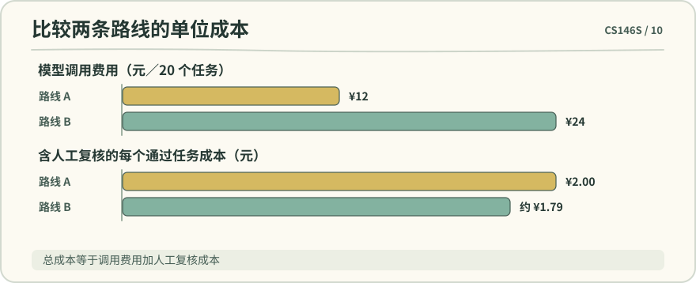
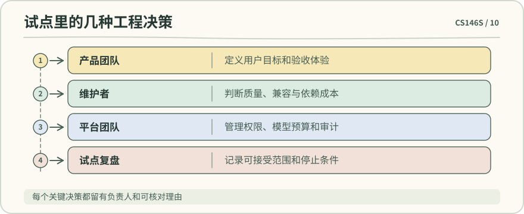
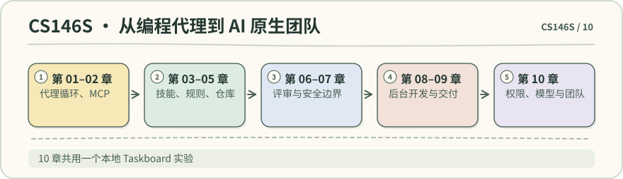

# 第 10 章 · AI 原生团队与未来

**对应 Fall 2026 第 10 周 · The AI-Native Team + The Future**

**课程预习**　按官网公布的 12 月 1 日与 12 月 3 日议题编写。内容和练习采用本书的教学设计。 [Fall 2026 课纲](https://themodernsoftware.dev/)

两个团队都想用 Taskboard 代理。产品团队只需要查询任务，工程团队还需要查看测试结果，并通过人工评审提交候选改动。组织层面的问题是，谁可以调用哪些工具，模型费用由谁承担，交付标准由谁维护。

## 1. 在组织内统一管理工具接入

MCP 门户是组织接入模式，可以集中发现工具、核对身份、分配权限、记录调用。Taskboard 试点中，产品角色只能请求列表和统计。工程角色可额外读取测试结果，提交仍进入现有评审流程。每次调用都应根据当前身份和工具作用域作决策。 [Cloudflare 企业 MCP 架构](https://blog.cloudflare.com/enterprise-mcp)

## 2. 让模型路由逐步接受评估

模型网关负责接收模型请求、执行路由与预算策略，并收集可观测数据。试点可以先把简单任务交给低成本模型，只在质量门槛无法满足且预算允许时尝试另一条路线。固定模型版本和测试集，比较成功率、延迟、调用费用和人工复核成本。应记录回退原因，按任务类型看结果。 [Cloudflare AI Gateway 文档](https://developers.cloudflare.com/ai-gateway/)

| 教学样本 | 评估通过 | 调用费用 | 人工复核 | 每个通过任务的成本 |
| --- | ---: | ---: | ---: | ---: |
| 路线 A，20 个任务 | 16 | ¥12 | 40 分钟 | ¥2.00 |
| 路线 B，同 20 个任务 | 19 | ¥24 | 20 分钟 | 约 ¥1.79 |

这里把人工时间按每分钟 ¥0.50 折算，再将调用和复核费用总和除以通过的任务数。表格使用虚构数据。若试点要求通过率至少 90%，路线 B 达标。项目还应事先约定最大成本、等待时间和必须人工复核的任务级别。

## 3. 团队用明确的办法保留工程判断

设计任务时先说明用户要完成什么，评审中查看用户行为和长期维护成本。质量标准可以记录为可执行验证，也可以由维护者当面查看具体案例。比如两种列表呈现都满足契约，一个需要新增依赖，另一个沿用现有输出。由维护者根据设备、兼容和维护约束解释最终决策，留一条可回查的记录。

## 结课演练

1. 以列表筛选为例，把规格、测试、评审意见、运行记录和两次发布演练串成一条可追溯链。
2. 为产品与工程角色各填一个工具权限表，明确批准人、访问范围和审核记录。
3. 用同一套样本比较两条模型路线。记录成本、通过率和复核结论，说明接受哪条试点路线及停止试点的条件。
4. 让另一位读者从交接记录找到规格，跑一次测试，再演示如何识别一个回归与回退到此前版本。

[上一章](../ch09/README.md) · [返回目录](../../README.md)
