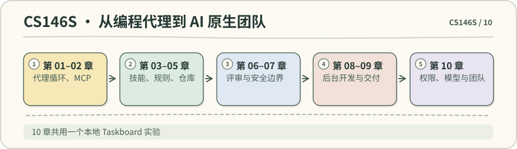

# CS146S · 现代软件开发者

斯坦福大学 **The Modern Software Developer** 的中文图解学习书，按 **Fall 2026** 课纲每周编写一章，共 10 章。先看约 200 行代码怎样让模型在磁盘上写出 `hello.py`，再从 Claude Code 的消息里认出同一个循环。接下来用一项任务板改动做规格、测试、评审、后台执行和发布回退。第 10 周按官网预告编写，截至 2026 年 11 月 26 日，两节 12 月的课仍是预习。 [课程官网](https://themodernsoftware.dev/) · [Stanford Bulletin](https://bulletin.stanford.edu/courses/cs-146s)

## 课程目录

| 章节 | 主题 | 动手完成 |
| --- | --- | --- |
| [01 · 拆开一个编程代理](Chapters/ch01/README.md) | 约 200 行的代理、Claude Code 的模型请求与响应 | 走读三种工具和两层循环，观察回执与上下文增长 |
| [02 · 上下文工程与 MCP](Chapters/ch02/README.md) | RePPIT、规格驱动、MCP 工具设计 | 写出状态筛选规格及只读工具契约 |
| [03 · Agent Skills 与命令行](Chapters/ch03/README.md) | SKILL.md、渐进加载、CLI | 把任务板检查流程做成可复用 Skill |
| [04 · 定制代理和仓库](Chapters/ch04/README.md) | 仓库指令、Hooks、角色分工 | 为实现和评审设置共同约束及检查入口 |
| [05 · 让代码库适合代理协作](Chapters/ch05/README.md) | 仓库入口、确定性验证、就绪审计 | 从干净检出复跑并修复一个协作障碍 |
| [06 · 用代理辅助代码评审](Chapters/ch06/README.md) | 证据链、分层评审、人工复核 | 针对一个打印顺序回归写出可验证评审意见 |
| [07 · 给开发代理划安全边界](Chapters/ch07/README.md) | SAST、SCA、秘密扫描、权限与信任边界 | 做一次只读权限和日志脱敏检查 |
| [08 · 后台代理与异步开发](Chapters/ch08/README.md) | 任务状态、工作树、重试与交接 | 模拟重复投递、并行冲突和陈旧任务 |
| [09 · 让团队用得起、接得住代理](Chapters/ch09/README.md) | 团队试点、角色分工、交付度量 | 比较原流程和代理流程的时间、完成率与复核成本 |
| [10 · 从团队接入到软件工厂](Chapters/ch10/README.md) | MCP 门户、模型网关、发布、回退与持续评估 | 设计权限和路由，再演练候选失败和发布后回退 |

从[前言](Chapters/PREFACE.md)了解实验项目和读法，或直接运行[第 1 章的 Python 实验](Chapters/ch01/README.md#3-离线跑完第一圈)。

## 20 讲与本书的对照

| 周次与章节 | 第一讲 | 第二讲 |
| --- | --- | --- |
| 第 1 周 · 第 1 章 | 01 · 9 月 22 日 · 用约 200 行 Python 搭建编程代理 | 02 · 9 月 24 日 · 读 Claude Code 的请求与响应 |
| 第 2 周 · 第 2 章 | 03 · 9 月 29 日 · 高级提示词、RePPIT 与规格驱动 | 04 · 10 月 1 日 · MCP 与工具调用 |
| 第 3 周 · 第 3 章 | 05 · 10 月 6 日（课件标 7 日） · Agent Skills | 06 · 10 月 8 日 · Lee Robinson 来宾课 |
| 第 4 周 · 第 4 章 | 07 · 10 月 13 日 · 仓库说明、Hooks 与子代理 | 08 · 10 月 15 日 · Boris Cherny 来宾课 |
| 第 5 周 · 第 5 章 | 09 · 10 月 20 日 · 仓库就绪度 | 10 · 10 月 22 日 · Eno Reyes 来宾课 |
| 第 6 周 · 第 6 章 | 11 · 10 月 27 日 · 用代理做代码评审 | 12 · 10 月 29 日 · Silas Alberti 来宾课 |
| 第 7 周 · 第 7 章 | 13 · 11 月 3 日 · AI 代码库安全 | 14 · 11 月 5 日 · Isaac Evans 来宾课 |
| 第 8 周 · 第 8 章 | 15 · 11 月 10 日 · 异步运行后台代理 | 16 · 11 月 12 日 · Rajesh Bhatia 来宾课 |
| 第 9 周 · 第 9 章 | 17 · 11 月 17 日 · Elad Gil 来宾课 | 18 · 11 月 19 日 · Amjad Masad 来宾课 |
| 第 10 周 · 第 10 章 | 19 · 12 月 1 日 · 大团队里的编程代理（预习） | 20 · 12 月 3 日 · 软件工厂（预习） |

示例源码、课件和官方作业入口放在相关章节。尚无可核验课堂内容的来宾课以课表信息为据，对应主题用标明来源的公开工程案例和本书练习展开。 [课程官网](https://themodernsoftware.dev/) · [讲次与资料索引](https://romanrose.github.io/llm_learn/generated/courses/cs146s-fall26/)

## 课程资料

- **Fall 2026 主线**　官网打开 **Syllabus** 查看逐周主题、阅读材料和课件。部分课件需要课程权限。 [2026 课程官网](https://themodernsoftware.dev/)
- **公开课堂文字记录**　第 1、2 周有关于代理结构、上下文和 MCP 的文字记录。 [9 月 24 日](https://themodernsoftware.dev/materials/9-24-26-transcript.txt) · [9 月 29 日](https://themodernsoftware.dev/materials/9-29-26-transcript.txt) · [10 月 1 日](https://themodernsoftware.dev/materials/10-1-26-transcript.txt)
- **官方作业与往年课纲**　以各自版本的课程页面为准核对周次。书中的 Taskboard 是自学用的独立练习。 [课程作业仓库](https://github.com/mihail911/modern-software-dev-assignments) · [Fall 2025 归档](https://themodernsoftware.dev/fall2025)
